# 05 · System Design（Staff 级，2026–2027）

> 定位：Staff / Senior Staff（Google L6–L7、Meta E6–E7、Amazon L6–L7 同级）后端/平台岗位。
> 语言约定：**中文 = 理解与笔记；English = 面试时直接说出口的句子。**

**目录** <a id="toc"></a>

- [0. 时间紧时的最短路径（算法和 AI 学习优先时用）](#s0)
- [目录](#h1)
- [1. Staff 级 SD 考什么](#s1)
  - [1.1 Senior vs Staff：同一道题，评分点不同](#s1-1)
  - [1.2 45 分钟框架（Meta/Google 常见）](#s1-2)
  - [1.3 60 分钟框架（Amazon/Stripe/部分 Staff loop）](#s1-3)
  - [1.4 Staff 级加分动作清单（每场至少做 3 个）](#s1-4)
  - [1.5 常见扣分](#s1-5)
  - [1.6 三个让推理“看得见”的习惯（边界 → 决策式审查 → 收尾）](#s1-6)
    - [习惯 1：先画边界，再放服务](#h2)
    - [习惯 2：“Do a reliability / security / cost review of this design” → 当成决策题，不背清单](#h3)
    - [习惯 3：每个回答以“取舍 + 风险 + 下一步检查”收尾](#h4)
  - [1.7 需求发现清单（0–5′ 用；7 项，问完写一张“需求与假设”便签）](#s1-7)
  - [1.8 被追问、被反驳、被改需求：五个固定套路](#s1-8)
- [2. 核心积木速查](#s2)
  - [2.1 Partitioning / Sharding](#s2-1)
  - [2.2 Replication & Consistency](#s2-2)
  - [2.3 Caching](#s2-3)
  - [2.4 Queues / Streams](#s2-4)
  - [2.5 Idempotency & Dedup](#s2-5)
  - [2.6 Outbox / CDC（双写问题）](#s2-6)
  - [2.7 Saga / Compensation](#s2-7)
  - [2.8 Workflow Engine & State Machine](#s2-8)
  - [2.9 Rate Limiting & Backpressure](#s2-9)
  - [2.10 Retries with Jitter](#s2-10)
  - [2.11 Multi-region / Multi-DC](#s2-11)
  - [2.12 Deterministic Routing / Gradual Rollout](#s2-12)
  - [2.13 Observability](#s2-13)
  - [2.14 Back-of-envelope 速查](#s2-14)
  - [2.15 Security & Recovery：身份优先授权 + RTO/RPO](#s2-15)
  - [2.16 迁移：分批（wave）、切换标准、回滚触发](#s2-16)
  - [2.17 从真实大事故学到的设计教训（Staff 加分素材）](#s2-17)
  - [2.18 Kafka 机制层追问 10 题（消息队列八股的 Staff 答法）](#s2-18)
- [3. 题库](#s3)
  - [3.1 ★ Distributed Rate Limiter](#s3-1)
  - [3.2 ★ Notification System（push / email / SMS / in-app）](#s3-2)
  - [3.3 ★ Payment System & Ledger（最高优先，领域最近）](#s3-3)
  - [3.4 ★ KYC / Identity Verification Platform（你的主场——但按“通用设计题”答）](#s3-4)
  - [3.5 ★ Workflow Orchestration Engine / Distributed Job Scheduler](#s3-5)
  - [3.6 ★ Webhook Delivery Platform](#s3-6)
  - [3.7 ★ Feature Flag & Dynamic Config Platform（含 policy-as-config）](#s3-7)
  - [3.8 ★ News Feed（Meta 高频，你的短板，必须练熟）](#s3-8)
  - [3.9 经典题关键点（每题 3–5 条）](#s3-9)
  - [3.10 领域题关键点](#s3-10)
  - [3.11 ★ Distributed Unique ID Generator（分布式唯一 ID 生成器）](#s3-11)
    - [方案 A：Snowflake（雪花算法）——本地算，不走网络](#h6)
    - [方案 B：号段模式 + 双缓冲（Leaf-segment, double buffer）——批量向数据库要号](#h7)
    - [怎么选](#h8)
    - [对外单号：别让竞争对手数出你的订单量](#h9)
    - [追问 & 英文回答](#h10)
    - [原帖纠错（照原帖说会被问倒的地方）](#h11)
  - [3.12 ★ Top-K / Trending（实时热门榜：最近一小时最热的 K 个）](#s3-12)
    - [主路径：按 itemId 分区 → 窗口计数 → 本地 top-k → 合并 → Redis](#h12)
    - [精确 vs 近似：Count-Min Sketch + Space-Saving](#h13)
    - [窗口与迟到数据：滚动 / 滑动 / watermark](#h14)
    - [热点、重算与上线](#h15)
    - [追问 & 英文回答](#h16)
- [4. 把我做过的系统当设计题来讲](#s4)
- [5. 资源](#s5)
  - [附：练习方法](#h5)
- [6. 中英术语表（面试用英文说）](#s6)

---

## 0. 时间紧时的最短路径（算法和 AI 学习优先时用） <a id="s0"></a> [↑ 目录](#toc)

SD 每周只给 **1 个 2–2.5h 时间块**（对应 00 的周六上午），其余时间留给算法和 AI。原则：**少读、多讲、靠 mock 暴露缺口（gaps）再补**。

| 做 | 不做 |
|---|---|
| 精读 §1.1、§1.2、§1.4、§1.6–1.8（≈ 50 分钟，一次） | 不从头读 §2——只在 mock 中卡住时查对应积木（building block） |
| 只练 **6 + 2 题**：Rate limiter · Notification · Payment & Ledger · Workflow / Job scheduler · News feed · “你做过的系统”（KYC）＋ AI：RAG with permissions · 你的合规（compliance） agent | 不刷 29 题；其余题在 Phase 3 按目标公司真题再补 |
| 每题一个循环：**45′ 口述 mock → 15′ 对照 §1.4 清单复盘（retro） → 在 08 勾选** | 不整本读 DDIA / Alex Xu；mock 暴露缺口后只读对应章节 |
| Mock 找 Claude：直接说 *“mock SD：<题名>，Staff 级，按 05 §1 评分”* | 不再看新课程——Educative SA 课和 Grokking *Modern System Design Interview*（按缺口挑读约 22 节）2026-10-26 已消化，要点并入 §1.6–1.8、§2.2/2.5/2.10/2.13–2.17、§3.3/3.5/3.8/3.9；面试前只看 [05a 速记卡](05a-sa-course-cheatsheet.md) |

**每题必须做到的 5 件事**（复盘时逐条打勾）：先写需求（requirements）与假设（assumption）便签（§1.7）→ 先画信任边界（trust boundary）和故障域（failure domain）（§1.6）→ 说出“难点”，深挖（deep dive） 2 处 → 讲一个部分失败（partial failure）场景和恢复 → 用“取舍（trade-off） + 风险 + 检查”收尾。

---

## 目录 <a id="h1"></a> [↑ 目录](#toc)

0. [时间紧时的最短路径](#s0)
1. [Staff 级 SD 考什么 & 时间分配框架](#s1)
2. [核心积木速查](#s2)
3. [题库（29 题，8 题完整拆解）](#s3)
4. [把我做过的系统当设计题来讲](#s4)
5. [资源](#s5)
6. [中英术语表](#s6)

---

## 1. Staff 级 SD 考什么 <a id="s1"></a> [↑ 目录](#toc)

### 1.1 Senior vs Staff：同一道题，评分点不同 <a id="s1-1"></a> [↑ 目录](#toc)

| 维度 | Senior（L5/E5）能过 | Staff（L6+/E6+）要额外展示 |
|---|---|---|
| **Scoping** | 列出功能需求、非功能需求（non-functional requirements） | **主动砍范围（cut scope）并说明为什么**；指出哪个需求决定架构（“这题的难点其实是 X”） |
| **驱动对话** | 跟着面试官提示走 | **自己掌控节奏**：先给全貌，再说“我建议深入 A 和 B，因为风险最大”，让面试官选 |
| **Tradeoff** | 知道 SQL vs NoSQL 各有优缺点 | **把 tradeoff 绑到需求上**并给出决定：“因为我们要的是 per-user 强一致（strong consistency）、跨用户无需事务（transaction），所以选按 userId 分片（sharding）的关系库（relational database）” |
| **失败模式** | 提到 retry、replica | **逐边界**讲部分失败（partial failure）：DB 写成功但事件没发、重复投递（redelivery）、乱序（out-of-order）、下游（downstream）半成功（partial success）；以及**如何发现**（监控）和**如何恢复**（重放（replay）、补偿（compensation）、人工） |
| **演进（evolution）** | 给一个终态（end-state）设计 | 给 **v1 → v2 → v3**：先上线什么、什么信号触发下一步、如何无停机（zero-downtime）迁移（migration） |
| **运维与组织** | 很少涉及 | 发布（release）策略（灰度（gradual rollout / canary）、shadow、回滚（rollback））、on-call、成本、多团队 ownership、API 契约治理、合规（compliance）/隐私 |
| **深度** | 每个组件讲到“用 Kafka” | 至少一处讲到**机制层**：分区键（partition key）、幂等键（idempotency key）存在哪、背压（backpressure）如何传导、重试（retry）为什么加 jitter |

> 一句话：**Senior 证明你会搭系统；Staff 证明你能为一个组织做对的取舍（trade-off），并让系统在出错时可恢复。**
> EN: "A Senior shows they can build a system; a Staff engineer shows they can make the right trade-offs for an organization and keep the system recoverable when things go wrong."

你的优势正好在 Staff 那一列的后四行（失败模式、演进、发布、跨团队契约）。弱项通常在**经典 C 端高并发（high concurrency）题**（feed、chat、cache）的量化与存储细节——这是本章题库要补的。

### 1.2 45 分钟框架（Meta/Google 常见） <a id="s1-2"></a> [↑ 目录](#toc)

| 时间 | 阶段 | 做什么 | 开口句（English） |
|---|---|---|---|
| 0–5′ | **需求 & 范围** | 功能 3–5 条；非功能（non-functional）（规模、延迟（latency）、一致性（consistency）、可用性（availability）、合规（compliance））；明确砍掉什么 | *"Before I draw anything, let me pin down scope. I'll focus on X and Y and explicitly leave Z out unless you want it."* |
| 5–8′ | **规模估算（estimation）** | DAU（daily active users）、QPS（queries per second；均值/峰值（peak））、存储、带宽；**只算会影响设计的数** | *"Let me do a quick estimate — mainly to decide whether a single primary is enough or we need to partition."* |
| 8–12′ | **API & 数据模型** | 3–5 个核心 API；核心实体与主键/分区键 | *"The partition key is the most consequential decision here, so let me call it out now."* |
| 12–22′ | **高层架构（high-level architecture）** | 画端到端（end-to-end）数据流；每个框说清职责；标出同步/异步（sync / async）边界 | *"Here's the happy path end to end. The synchronous part ends here; everything after this is async."* |
| 22–38′ | **深挖 2 处** | 选风险最大的 2 个点：热点、一致性（consistency）、失败恢复、扩展 | *"I'd like to go deep on two things: how we stay correct under duplicate delivery, and how we handle the hot-key case. Does that match what you want to see?"* |
| 38–43′ | **失败、运维、演进** | 部分失败表、监控（monitoring）指标（metrics）、发布与回滚（rollback）、v2 演进 | *"Let me walk through what breaks first as we grow 10x, and how we'd know."* |
| 43–45′ | **总结** | 复述关键决策和代价 | *"To summarize the key tradeoffs: we chose A over B because..., accepting the cost of..."* |

### 1.3 60 分钟框架（Amazon/Stripe/部分 Staff loop） <a id="s1-3"></a> [↑ 目录](#toc)

在 45′ 框架基础上：需求 7′、估算 5′、API/模型 8′、高层 12′、**深挖 18′（3 处）**、失败/运维/演进 7′、总结 3′。多出的时间**花在深挖和演进**，不要花在画更多框。

### 1.4 Staff 级加分动作清单（每场至少做 3 个） <a id="s1-4"></a> [↑ 目录](#toc)

- [ ] 说出**“这道题真正的难点”**，并据此排序深挖。
- [ ] 至少一处给出**被否决的方案（rejected alternative）**和否决理由。
- [ ] 主动画**状态机（state machine）**（订单/支付/验证/任务），而不是只画服务框。
- [ ] 讲一个**部分失败场景**（写库成功、发消息失败）及恢复方式（outbox / reconciliation）。
- [ ] 讲**发布**：feature flag、灰度（gradual rollout / canary）百分比、shadow、回滚（rollback）条件。
- [ ] 讲**可观测性（observability）**：哪 3 个指标告警（alerting），SLO 是什么。
- [ ] 讲**演进**：v1 用最简单的方案，什么信号触发 v2。
- [ ] 讲**组织边界（organizational boundary）**：哪个团队拥有哪个数据，契约（contract）如何版本化（versioning）。
- [ ] 讲**成本**（外部 vendor 按次收费、存储冷热分层）。
- [ ] 第一张图先画**信任边界（trust boundary）和故障域（failure domain）**，再放具体技术（§1.6 习惯 1）。
- [ ] 收尾给出**取舍（trade-off）的代价 + 会推翻设计的风险 + 能产生证据（evidence）的检查**（§1.6 习惯 3）。
- [ ] 容量（capacity）估算从**实测单机容量**出发，并说清冗余（redundancy）防的是“丢一台”还是“丢一个 AZ”；顺带点出**配额（quota）**会挡住扩容（scale-out）（§2.14）。
- [ ] 被改需求 / 被反驳时，先说**哪条假设（assumption）变了**，只改图的一处，再给两方案对比（§1.8）。

### 1.5 常见扣分 <a id="s1-5"></a> [↑ 目录](#toc)

- 一上来就画 Kafka + Redis + Cassandra，说不清为什么。
- “exactly-once” 一笔带过。（要**说清幂等（idempotent）在哪一层、副作用（side effect）如何去重（dedupe）**。）
- 估算算了一堆数但没有用来做任何决定。
- 被问“如果 X 挂了”时只回答“加 replica”。
- 被问“如果 X 变慢”时一口气报出 retry + 队列 + DLQ + 熔断（circuit breaker），却不说牺牲什么、新组件带来什么新故障模式（failure mode）。答法见 [§1.8 套路 5](#s1-8)。
- 不给结论：“都可以，看情况”。Staff 要说 *"Given these requirements, I'd pick X."*

### 1.6 三个让推理“看得见”的习惯（边界 → 决策式审查 → 收尾） <a id="s1-6"></a> [↑ 目录](#toc)

> 来源：Educative *Solutions Architect Interview Prep* 课程通讯（2026-10，Naeem ul Haq），按 Staff 后端 SD 改写。原文面向 SA 设计轮，但核心判断通用：**面试官打分的是每个框和箭头背后的理由，服务名写对不加分。**
> 和本章关系：习惯 1 是 §1.5 第一条扣分（red flag）项的正面做法；习惯 2 是“review this design”类追问（follow-up question）的标准答法；习惯 3 升级 §1.2 最后 2 分钟的总结。

#### 习惯 1：先画边界，再放服务 <a id="h2"></a> [↑ 目录](#toc)

第一张图只用**按职责命名的框**（"API tier"、"decision service"、"ledger store"），然后画两种线：

| 线 | 含义 | 它回答面试官的哪个问题 | 典型位置 |
|---|---|---|---|
| **Trust boundary**（信任边界） | 暴露面（exposure / attack surface）、身份或数据敏感度发生变化的地方 | 哪里要认证（authentication）/鉴权（authorization）、校验输入、加密（encryption）、脱敏（redaction）？ | 公网 ↔ edge/gateway；应用层 ↔ 数据层；我方 ↔ 第三方 vendor（出站调用 + 入站回调）；PII 区 ↔ 非 PII 区 |
| **Failure domain**（故障域） | 会因同一个故障一起挂掉的一组组件 | 什么会一起挂？挂掉一个时谁还在服务？ | AZ / DC / region；共享的 DB 主库（primary）、Kafka 集群；**同一家 vendor**；**同一次配置推送（config push）或发布**（最常被忽略的故障域） |

再标出请求路径和 sync/async 分界（§1.2 的 12–22′ 已要求）。**具体技术（Kafka、Redis…）等某个需求要求它时再贴上，并说出是哪个需求。** 例如：两个 AZ 都放应用容量，就能直接说出“丢一个 AZ 时谁继续扛流量”。

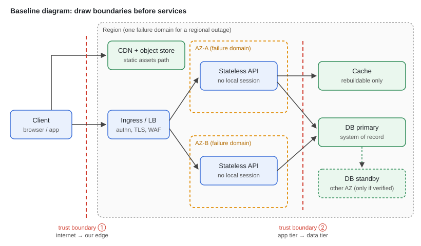

画图细则（来自课程免费课 *Draw a Baseline Diagram…*）：
- **信任边界（trust boundary） ≠ 授权（authorization）**。边界只说明“数据层不接受公网直连、只有应用层通向数据层”；**哪个身份能发哪个请求**是授权问题，单独讲（§2.15）。面试官追问“这条线就安全了吗”时，正确回答是“不，这条线只限定路径，授权靠身份”。
- **箭头只画请求流**，不画管理、监控、部署连线——否则图上看不出请求走哪。
- **静态资源单独走一条路**（对象存储 + CDN），不让应用层逐个转发图片。
- **只声明你验证过的韧性**：cache、DB 在 baseline 里先是“逻辑角色”，复制（replication）和 failover 机制没讲清前，不要说“高可用”。
- **不加没有需求撑腰的组件**（队列、搜索集群、第二个 region…）；要加就同时说出它挂了会怎样。
- **1 分钟从左到右口述**：客户端 → 公网边界 → ingress → 无状态（stateless）应用（两个故障域（failure domain））→ cache / DB（数据层边界后）+ 静态资源路径。口述本身会暴露假设（一个 region 够不够、session 不存本地），这正是要让面试官听到的。

- *"Before I name any technologies, let me draw two kinds of lines: where trust changes, and what can fail together. That tells us where we need authentication and validation, and which components must not share a failure domain."*

#### 习惯 2：“Do a reliability / security / cost review of this design” → 当成决策题，不背清单 <a id="h3"></a> [↑ 目录](#toc)

各家云的 Well-Architected 框架 pillar 划分不同，背 pillar 名不加分。被问到时可以一句话点破差异，然后切换到共通关注点：

| 云 | 结构 | 要点 |
|---|---|---|
| AWS | 6 pillar | Operational Excellence、Security、Reliability、Performance Efficiency、Cost Optimization、Sustainability |
| Google Cloud | 6 类 | 与 AWS 大体对应，但把 **security, privacy and compliance** 合成一项，性能叫 performance optimization |
| Azure | 5 个核心 pillar | Reliability、Security、Cost Optimization、Operational Excellence、Performance Efficiency；**sustainability 是核心之外的单独指南** |

> 来源：课程免费课 *Use Well-Architected as a Decision Conversation*（2026-10）。各家框架会更新，面试前以官方文档为准。

按**共通关注点**讲：security、reliability、performance、cost（可加 operability）。每个关注点固定四步：

**Requirement（需求）→ Risk（当前设计哪里会不满足）→ Smallest change（最小改动）→ Evidence（什么证据证明改对了）**

“最小改动”是 Staff 信号——不借审查之名重新设计；“证据”把话题接到 §2.13 可观测性（observability）和 §2.12 灰度（gradual rollout / canary）。

| 关注点 | Requirement | Risk | Smallest change | Evidence |
|---|---|---|---|---|
| Performance | 一次性 500K 验证要在可控时间内消化 | 加 pod 只会制造更多 vendor throttle（§2.14） | 队列削峰（load leveling） + per-vendor 令牌桶（token bucket） | 压测（load test）下 throttle 率、backlog age、清空时间 |
| Reliability | 丢一个 DC 不中断验证流程 | 有进行中流程的状态在本地内存 | 状态外置（externalize） + 延迟重试（retry）走消息 | DC 故障演练（game day）期间的错误率与恢复时间 |
| Security | PII 不出现在日志/指标里 | 调试日志打印原始请求 | 字段级脱敏，日志只记 hash | 日志扫描规则零命中、审计（audit）抽查 |
| Cost | vendor 按次计费，重试不能重复收费 | 超时（timeout）后重试 → 同一用户被付费调用两次 | 调 vendor 前按幂等键（idempotency key）去重 | 每次验证的付费调用数 ≈ 1.0 |

> 上表是**答题模板**，不是“我们做过”的陈述；用自己的项目回答时套这四列。

- **改动要“相称”**：权限过宽 → 收窄身份权限 + 审计证据，不需要报一串安全服务名；预算紧 → 找闲置/超配容量 → 有度量的调整 → 用成本与利用率（utilization）信号验证，**同时盯性能回退**。
- **证据是证据，不是保证**：压测、延迟（latency）、错误率趋势只能支撑决定，不要说成“这样就保证不会挂”。
- **被反驳时看面试官在考什么**：考框架记忆，pillar 名就够；考架构判断，答案必须是 需求 → 风险 → 相称的改动 → 承认的代价 → 可观测的证据。

- *"For reliability, the requirement is surviving the loss of one data center. The risk in this design is in-flight state held in memory. The smallest change is moving that state out and driving retries through the queue. And I'd want evidence: a controlled failover drill where error rate and recovery time stay within the SLO."*

#### 习惯 3：每个回答以“取舍 + 风险 + 下一步检查”收尾 <a id="h4"></a> [↑ 目录](#toc)

画完图不要说“done”。收尾三件套：

1. **我选的取舍（trade-off） + 它的代价**：*"We're starting with one region and two availability zones because it keeps the design simple and survives a zone loss. The cost: users far from that region see higher latency, and a full regional outage is still an open risk."*
2. **会推翻这个设计的风险**（= v2 的触发信号，接 §1.4 “演进”）：流量超过估算峰值（peak）；cache 命中率（hit ratio）不足以压住 DB；数据分级要求更强的隔离（isolation）或保留期（retention period）控制；业务要求的 RTO/RPO 超过 baseline 能给的；业务不能接受整个 region 挂掉；某个依赖（dependency）的硬上限比假设低。
3. **能产生证据的检查**：
   - **先确认压测输入**：峰值请求数、读写比、payload 大小、可接受延迟——输入错了，压测结果没有意义；
   - 和业务、安全方**确认数据分级**；
   - 受控地干掉一个 AZ/DC 的应用容量，验证请求仍能继续；注入 vendor 超时（timeout）；shadow 流量；对账（reconciliation）报告。

- *"So the main trade-off is X over Y, and we pay for it with Z. Two things would change this design: A and B. Before trusting it in production I'd run a load test at three times the estimated peak and a controlled zone failure."*
- 这一收尾告诉面试官**你知道设计会在哪里坏**——这本身就是 Staff 评分点（evaluation criteria）。

### 1.7 需求发现清单（0–5′ 用；7 项，问完写一张“需求与假设”便签） <a id="s1-7"></a> [↑ 目录](#toc)

来源：课程 *Drive Discovery with a Requirements Checklist and Assumptions*（2026-10-26 登录后读完全文，下表与便签已按全文校对）。核心观点：**过早报出 cache / DB / LB，就把设计锁进了没验证过的假设里**——同样是 browse → cart → checkout，单 region 还是多 region、目录能不能短暂过期、峰值时 checkout 是否必须正确，架构完全不同。

| # | 问什么 | 它决定什么 | 一句 English |
|---|---|---|---|
| 1 | **用户与客户端类型**：C 端浏览器/App、内部运营、合作方 API | 认证方式、流量形态、要支持的接口 | *"Who are the callers — end users, internal operators, or partner systems?"* |
| 2 | **地域 / region** | 网络路径、数据驻留、能接受的恢复方案 | *"Is this one market or several? Any data-residency rules?"* |
| 3 | **峰值 vs 均值** | 是否要削峰（load leveling）、自动扩容（autoscaling）、预热（pre-warming） | *"What's the peak-to-average ratio, and is the peak predictable, like a sale?"* |
| 4 | **延迟** | 同步/异步分界、缓存（cache）、就近部署（deploy close to users） | *"What latency does the user actually notice, and on which path?"* |
| 5 | **数据敏感度** | 信任边界（trust boundary）、加密、脱敏、保留期 | *"Which data is sensitive — PII, payment data — and who's allowed to see it?"* |
| 6 | **可用性（availability）**（含 RTO/RPO） | 故障域（failure domain）数量、复制方式、DR 层级 | *"If we lose a zone or a region, how long can we be down and how much data can we lose?"* |
| 7 | **预算** | 托管 vs 自建、冷热分层（hot/cold tiering）、vendor 调用成本 | *"Is there a cost ceiling I should design under?"* |

**问完立刻写一张便签**（白板（whiteboard）角落 / 共享文档顶部），后面每个决定都指回它：

```
Confirmed:  web + mobile shoppers; one market; checkout must be correct at peak
Assumed:    peak ≈ 10× average (flash sale); catalog may be stale ≤ 1 min; PII + payment refs
Priorities: 1) checkout correctness  2) availability during peak  3) cost
Out of scope: recommendations, search ranking, seller tools
```

- *"I'll write these down as assumptions; if any of them is wrong, tell me and I'll show you which part of the design changes."*——**主动把假设变成可以被推翻的东西**，是 Staff 的 scoping 信号（§1.1）。

全文补充的三点：
- **需求要排优先级（prioritize）**（P1 / P2 / P3），个性化、营销通知、分析报表这类“有价值但不是第一版必须”的需求**停车**。拿不准就请面试官排序：*"If I had to rank these, I'd put checkout correctness first and personalization out of scope — does that match your priorities?"*
- **用一句话收束需求**（可直接套）：*"We're designing X for Y users. The priorities are A and B. I'm assuming C and D, and I still need E."*
- **只要“能改变下一个决定”的那条证据**：峰值并发数据验证流量假设；数据分级验证敏感边界；SLO 把“高可用”变成可观测目标。没改变决定的问题不问。

### 1.8 被追问、被反驳、被改需求：五个固定套路 <a id="s1-8"></a> [↑ 目录](#toc)

> 来源：Educative *Solutions Architect Interview Prep* 付费章节（2026-10-26 读完）中的 *Critique the Storefront Design*、*Choose an Execution Model*、*Objection Handling*、*Run a Full Mock … With a Requirement Change*。原文面向 SA 的客户对话，这里只保留 Staff SWE 设计轮也会遇到的部分。

**套路 1：选型 / “为什么用 X” → 两分钟决策句（5 段）**

需求 → 决定 → **被否决的每个方案各一句理由** → 最不确定的假设 + 要什么证据 → 什么变化会推翻这个选择。
- *"We need container compatibility and separately scalable web and worker processes, and a small on-call team. So I'd run it on a managed container platform. I ruled out functions because we may hold long-lived connections, a PaaS because worker control is too constrained, and VMs because host patching exceeds the team. The shakiest assumption is connection behavior — I'd want traces of request duration and concurrent connections. If we do need long-lived bidirectional sessions, that changes the choice."*
- 补一句常被追问的：**托管服务减少的是运维量，不是责任**（*"Managed services reduce toil, not accountability."*）——身份权限、数据保护、配置正确性（correctness）、监控告警（monitoring and alerting）永远是自己的。“为什么不全用托管”要答成**需求问题**：自定义 runtime、可移植性、数据驻留（data residency）、出网（egress）成本/延迟、可观测性（observability）不够。

**套路 2：被质疑优先级（“为什么先做这个，不先加缓存？”）**

1. 把**一个**下一步绑到最重要的需求上（例如 checkout 不能停 → 先消除未测试过的单点（single point of failure）故障域（failure domain））。
2. 点名一个替代方案，按**它的真实代价**否决：加缓存改善浏览延迟，但不降低 checkout 依赖的故障风险；“到处加冗余（redundancy）”贵且复杂，还没先解决最关键的那个边界。
3. 反问**哪条假设会改变排序**：哪条用户路径最重要？已约定的可用性/延迟/恢复目标是什么？哪些组件已经有测试过的冗余和回滚（rollback）？
- *"I'd still do this first because it protects the revenue path. Caching helps browse latency but doesn't touch checkout's failure risk. What would change my ranking is if checkout already has a tested failover — then latency becomes the top risk."*

**套路 3：被反对（“太贵了” / “会被锁定” / “为什么不多云” / “安全合规会卡住”）**

固定循环：**把反对改写成可验证的担忧 → 问一个问题找真实动因 → 说清近期 vs 长期的取舍（trade-off） → 选择缩范围 / 缓解 / 小实验 → 收尾给“谁、何时、交付什么”**。

| 反对 | 找动因的那一个问题 |
|---|---|
| 太贵 | *"Is the concern upfront spend this quarter, or the total cost over three years?"*（前者 → 缩小第一期范围；后者 → 做敏感性分析） |
| 锁定 | *"Which dependency would be most costly to change later — runtime, data format, skills, contract, or a managed feature?"*（缓解：定义可移植边界——schema 文档、导出流程、IaC、接口隔离 provider 特有行为） |
| 多云 | *"What failure, commercial or regulatory risk must multi-cloud reduce?"*（小实验：只验证那个需求，比如把可移植数据恢复到第二个环境，而不是所有组件双份） |
| 合规会卡 | *"Which specific obligation or evidence requirement would block phase one?"*（做一次有范围的差距评估，不承诺“我们合规”） |

- 收尾句：*"The main concern is ⟨X⟩. I recommend ⟨re-scope / mitigation / experiment⟩, accepting ⟨near-term cost⟩ to reduce ⟨long-term risk⟩. Before committing we need ⟨evidence⟩, and ⟨owner⟩ can have it by ⟨date⟩."*
- 这套也适用于**跨团队（cross-team）设计评审（design review）**和 behavioral 的 “disagreement” 题（07 G1/G3）。目标不是驳倒对方，是让分歧（disagreement）变成证据能回答的问题。

**套路 4：面试中途改需求（例如 “EU 客户的数据不能出 EU”）**

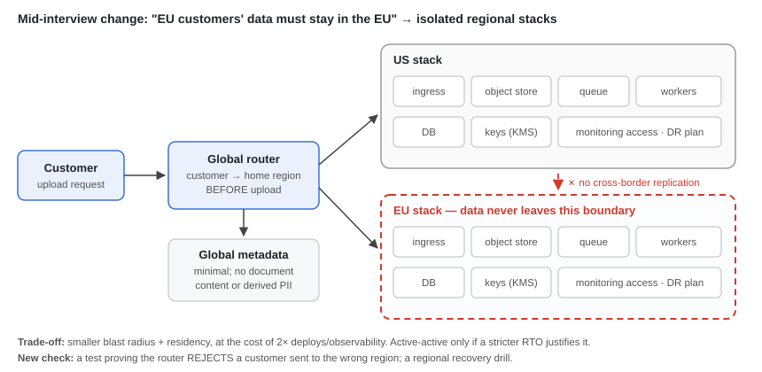

1. **说出便签上哪条假设变了**（§1.7），不要“顺手加个复制”。
2. **只改拓扑的一处**：驻留 → 上传前就按客户归属路由；每个客户记录带上它的数据区域；部署**隔离的 EU 区域栈**（自己的 ingress、对象存储、队列、worker、DB、密钥（secrets）、监控权限、恢复计划）；全局只留最少的运维元数据（metadata），并核实其中没有文档内容或派生敏感字段。
3. **两方案对比**：区域隔离（爆炸半径（blast radius）小、满足驻留，代价是发布/观测复杂度翻倍）vs 多区域 active-active（可用性更好，但更难保证数据不越界）。没有更严格的 RTO 要求时选隔离。
4. **更新收尾**：新的取舍、新风险（意外跨境数据流动）、新检查（**测试路由会拒绝错误的驻留分配**、区域恢复演练）。
- *"That changes my assumption about a single data boundary. Instead of replicating, I'd route each customer to its home region before upload and stand up an isolated EU stack. It costs us a second deployment to operate; it buys us residency and a smaller blast radius."*

**套路 5：被追问“如果 X 变慢 / 挂了怎么办” → 先锁定损失边界（loss boundary），不往上堆组件**

> 来源：小红书「SDE面 L5 被定成 L4，输在讲不出取舍」（作者自称面试官，6 页图文，2026-11-04 读）。原帖是情绪化的观点文，这里只留可操作的部分，并补上它没讲清的几处（见下方“原帖要补的地方”）。

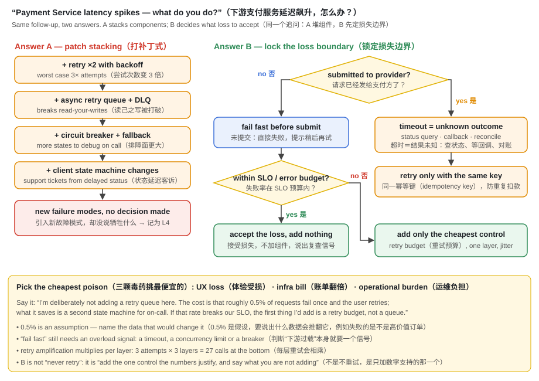

面试官随口一句 *"What if the Payment Service latency spikes?"*，常见的扣分答法是一口气报出重试（retry） + 指数退避（exponential backoff） + 异步重试队列（async retry queue） + 死信队列（DLQ） + 熔断（circuit breaker） + 降级兜底（fallback）。每个组件都“对”，但**没有一个决定**：没说要牺牲什么，也没说新组件带来的新故障模式（failure mode）。在评分表（rubric）上这就是“会用工具、不会做取舍”的证据。

每加一个组件都有代价，答的时候要说出来：
- **重试**：下游（downstream）数据库因锁竞争（lock contention）变慢时，每次失败再重试 2 次，最坏情况下打到下游的尝试次数变成 **3 倍**；每层都这样就**逐层相乘**（3 层 → 27 倍，见 [§2.10](#s2-10)）。没有重试预算（retry budget）、限流（rate limiting）和抖动（jitter），就会形成重试风暴（retry storm），把小事故变成级联故障（cascading failure）。
- **异步重试队列**：原本同步完成的操作变成异步，如果写入确认和查询语义没处理好，就打破读己之写（read-your-writes）：用户刚付完款却看到“未支付”。前端状态机要跟着改，客服还会多收一批“状态不对”的工单。
- **熔断 + 兜底**：又多一套状态，值班（on-call）排查时要多看一层。

**答法：先分清“请求有没有发出去”，再决定接受什么损失（4 步）**
1. **划边界**：请求**还没提交**给支付方 vs **已经提交但超时**，两类的处理完全不同。
2. **没提交的 → 快速失败（fail fast）**，让用户稍后再试。给出量级并标明是假设：*"Say this is about 0.5% of requests during an incident."* 再对照 SLO / 错误预算（error budget）：在预算内就**故意不加**异步队列，换来更低的代码复杂度和值班成本。
3. **已提交但超时的 → 结果未知（unknown outcome）**：通过状态查询（status query）、回调（callback）或对账（reconciliation）确认结果；要重试只能用**同一个幂等键（idempotency key）**，否则就是重复扣款（double charge）。这条不能“接受损失”，因为钱可能已经扣了。
4. **说出复查信号**：什么数据会让你改主意，到那时加的第一个控制是什么（通常是重试预算，而不是队列）。

> EN: *"I'd split this by whether the request reached the provider. If it hasn't, I fail fast and let the user retry — say that's about half a percent of requests during an incident, which stays inside our error budget. I'm deliberately not adding an async retry queue for that: it would cost us a second state machine and break read-your-writes for a small gain. If the request did reach the provider and timed out, the outcome is unknown, so I confirm it through a status query or reconciliation and only retry with the same idempotency key. If the failure rate starts eating the error budget, the first thing I'd add is a retry budget, not a queue."*

**取舍的本质是选哪个代价**：用户体验受损（UX loss）、基础设施账单变大（infra cost）、团队背上运维负担（operational burden），三个里挑一个最便宜的，并说清为什么。“Kafka 和 RabbitMQ 谁吞吐（throughput）高”、背 CP / AP 这类脱离业务约束的对比不算取舍。
> EN: *"Every option here costs something — user experience, infra spend, or operational burden. I'm choosing to pay in ⟨X⟩ because ⟨requirement⟩, and here's the signal that would make me switch."*

**原帖要补的地方（照原帖说可能被追问倒）**

| 原帖说法 | 问题 | 面试里改成 |
|---|---|---|
| “下游过载时直接 fail 掉尚未提交的请求” | 判断“过载”本身就要一个信号：超时、并发上限（concurrency limit）或熔断。这其实也加了控制，只是只加了一个 | 说清用哪个信号判断过载，并承认这是**唯一**加的控制 |
| “这类请求占 0.5%” | 数字是作者假设的。如果失败的恰好是高价值订单，损失可能远大于复杂度成本 | 明说是假设，并说出**什么数据会推翻它**（失败率、订单金额分布、对 SLO 的消耗） |
| 只举了“加”和“不加”两个极端 | 中间有便宜的选项：一层重试 + 重试预算（如重试量不超过正常流量的 10%）+ 抖动 | 答法 B 不是“永远不重试”，而是**只加数据支持的那一个控制，并说出没加什么** |
| 结尾提到 “Reverse Decision Tree” 和“四步叙事结构” | 原帖没给内容（作者说之后再写），不能当成已知框架引用 | 用本节的 4 步；挖项目里的取舍用 [§4.3](#s4)（约束 → 选择 → 替代方案 → 代价） |
| 首屏唯一一条评论：“L5 不需要这种级别的取舍” | 对 L5 也许成立，但你面的是 Staff，这正是加分项 | 无需理会，按 Staff 标准准备 |

<small>📖 名词解释</small>
<small>

- **损失边界（loss boundary）**：先说清“出事时最多损失什么、损失落在谁身上”，再决定加不加组件。
- **快速失败（fail fast）**：发现下游扛不住就立刻返回错误，不排队、不硬等，免得请求堆积拖垮自己。
- **错误预算（error budget）**：SLO 允许的失败量。例如 99.9% 可用，就允许 0.1% 的请求失败，预算没用完就不必为剩下的失败加复杂度。
- **重试预算（retry budget）**：给重试设总量上限，例如重试请求不能超过正常请求的 10%，超出就不再重试，防止重试风暴。
- **读己之写（read-your-writes）**：自己刚写入的数据，自己马上能读到。改成异步后容易被打破。
- **结果未知（unknown outcome）**：请求发出后超时，你不知道对方有没有执行成功，只能去查，不能当成失败。
- **运维负担（operational burden）**：系统上线后团队要持续付出的值班、排障、升级成本。
- **死信队列（DLQ, dead-letter queue）**：重试到上限仍失败的消息放进去，等人工或单独流程处理。
</small>

---

## 2. 核心积木速查 <a id="s2"></a> [↑ 目录](#toc)

每块格式：**要点** → **面试常见追问（follow-up question）**。面试里可以顺手用自己做过的系统举一个例子，一场用 1–2 次即可，不要喧宾夺主。（带真实项目例子的完整版只存在本地：project_deep_dive 第 31 篇。）

### 2.1 Partitioning / Sharding <a id="s2-1"></a> [↑ 目录](#toc)

- **要点**：选分区键（partition key） = 选“哪些操作需要在同一分片（sharding）内完成”。Hash 分区均匀但范围查询（range query）差；Range 分区利于范围扫描但有热点（hot spot）；一致性哈希（consistent hashing）减少扩容（scale-out）迁移（migration）量。热点 key 用加盐/拆分/本地缓存（in-process cache）。二级索引（secondary index）：local（scatter-gather 读）vs global（写放大、异步）。
- **追问**：重新分片（sharding）怎么不停机？跨分片事务（transaction）怎么办？热点用户怎么办？

### 2.2 Replication & Consistency <a id="s2-2"></a> [↑ 目录](#toc)

- **要点**：单主（single-leader；简单、写入瓶颈（bottleneck））/ 多主（multi-leader；冲突解决（conflict resolution））/ 无主（leaderless）quorum（R+W>N）。读己之写（read-your-writes）、单调读（monotonic reads）、因果一致（causal consistency）。同步（sync）vs 异步（async）复制（replication） = 延迟（latency） vs RPO。线性一致性（linearizability）只在真正需要的地方用（余额、唯一性、锁）。
- **追问**：用户刚改完资料就刷新看不到怎么办？跨 region 写冲突（conflict）？
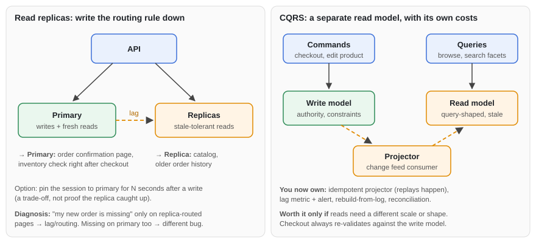

- **读副本（read replica） = 读容量，不是正确性（correctness），也不是 failover 方案**（课程补充）。要**显式写出路由规则**：需要新鲜度（freshness）的读（下单确认页、下单后立即查库存）→ 主库（primary），或用该库有书面新鲜度契约的一致性（consistency）特性；能容忍旧数据的读（目录、历史订单）→ 副本；写后把该 session **钉在主库一段时间**是折中，不是“副本一定追上了”。诊断信号：**只有走副本的页面**报“刚下的单不见了” → 复制延迟（replication lag） / 路由；走主库的页面也没有 → 别的问题。
- **CQRS 是读模型的极端版**：只有当读侧需要**不同的规模或不同的数据形状**（不同索引、文档结构）时才值得。代价是 projector 代码、**projector 也要幂等（idempotent）**（会重放（replay））、投影延迟（projection lag）指标（metrics）+告警（alerting）、可从变更日志重建读模型、对账（reconciliation）。读侧没有写模型给不了的需求（requirements） → 副本 + 缓存（cache）就是更好的答案。*"CQRS earns its cost only when reads need a different scale or shape than the write model can serve."* 下单永远对**写模型**做最终校验，不信展示出来的价格/库存。

### 2.3 Caching <a id="s2-3"></a> [↑ 目录](#toc)

- **要点**：cache-aside / read-through / write-through / write-behind；TTL + 主动失效；防击穿（singleflight / 互斥重建）、防雪崩（TTL 抖动（jitter））、防穿透（空值缓存 / Bloom filter）。多 pod 下**本地缓存 = 不一致来源**。
- **追问**：缓存和 DB 怎么保持一致？热 key（hot key）？

### 2.4 Queues / Streams <a id="s2-4"></a> [↑ 目录](#toc)

- **要点**：队列用于工作分发；日志流（log stream）支持重放（replay）、多个消费组与分区内顺序。分区键（partition key）、背压（backpressure）和消费幂等（idempotent consumption）需要明确语义。
- **追问**：一个消费组积压时，哪些资源仍会影响其他工作？排序覆盖哪个topic、分区和实际写者？
- **Kafka 机制层**（ISR、高水位（high watermark）、重平衡（rebalance）、exactly-once 的边界、不丢数据三段配置）见 [§2.18](#s2-18)。

### 2.5 Idempotency & Dedup <a id="s2-5"></a> [↑ 目录](#toc)

- **要点**：幂等键（idempotency key）（客户端生成 / 业务自然键）+ 结果存储；“检查-执行”必须原子（唯一约束（unique constraint）、条件写（conditional write）、CAS（compare-and-set））。内容哈希（content hash）去重适合“数据没变就不重做”。区分：**消息去重 ≠ 副作用（side effect）去重**（邮件、外部调用、扣款（charge）要各自有幂等（idempotent））。
- **追问**：幂等键（idempotency key）存哪、存多久？并发两个相同请求同时到？
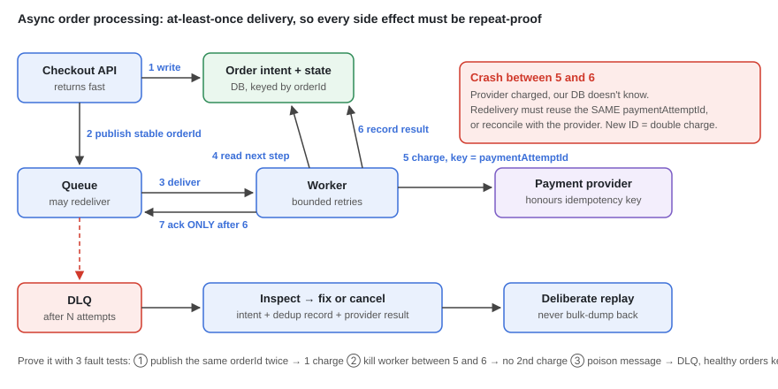

- **关键坑：每次重试（retry）生成新的 attemptId = 白做**——重复扣款缺陷又回来了。幂等键必须**稳定**（orderId + paymentAttemptId），并且**一直带到外部 provider**。只在自己库里写去重记录不够：**provider 已扣款、worker 在记录完成前崩溃**时，本地记录证明不了外部扣没扣——要么复用同一个 provider 侧幂等键，要么和 provider 对账（reconciliation）。
- **worker 只在“记录安全结果之后”才 ack**；处理流程：读 workflow 状态 → 做下一个未完成步骤 → 落状态 → ack。
- **DLQ 不是完成路径**：进 DLQ 的消息带 orderId、操作名、尝试次数、失败原因；恢复前先查 order intent、去重记录、provider 结果，修好原因或取消订单再**有意识地**重放（replay）——**盲目整批回灌主队列只会重建 backlog**。重试要区分瞬时 vs 永久失败，并设上限。
- **用 3 个故障注入（fault injection）测试证明“一次逻辑支付 ≤ 一次扣款”**（Staff 加分：给出验证方式而不只说“我们幂等”）：① 同一 orderId + attemptId 发两次 → 一次扣款一条记录；② provider 接受后、记录完成前杀掉 worker → 恢复时复用同一幂等键或对账；③ 构造永久失败 → 达到上限进 DLQ，健康订单不受影响。

### 2.6 Outbox / CDC（双写问题） <a id="s2-6"></a> [↑ 目录](#toc)

- **要点**：“写 DB + 发消息”不是原子的。Transactional outbox：同一事务写业务表 + outbox 表，relay（轮询或 CDC/Debezium）投递（delivery），消费者幂等（idempotent）。CDC：直接从 binlog 流出变更。
- **追问**：relay 挂了？重复投递？outbox 表膨胀？

### 2.7 Saga / Compensation <a id="s2-7"></a> [↑ 目录](#toc)

- **要点**：跨服务长事务拆成本地事务 + 补偿（compensation）；编排（orchestrator）vs 协同（choreography）。有些副作用**不可逆**（已发邮件、已调外部 vendor、已限制账户）→ 要设计“前向修正”而非回滚（rollback）。
- **追问**：补偿也失败了？如何保证最终一致（eventual consistency）？

### 2.8 Workflow Engine & State Machine <a id="s2-8"></a> [↑ 目录](#toc)

- **要点**：长流程（分钟到天）需要持久化（persist）状态、定时器（timer）、重试（retry）、人工步骤 → 显式状态机（state machine）或 workflow engine（Temporal/Cadence/Step Functions）。状态要区分“处理中 / 等用户 / 等人工 / 技术失败 / 业务失败 / 完成”。
- **追问**：为什么不直接用 Temporal？状态爆炸怎么办？

### 2.9 Rate Limiting & Backpressure <a id="s2-9"></a> [↑ 目录](#toc)

- **要点**：token bucket（允许突发）/ leaky bucket（平滑）/ fixed vs sliding window。分布式限流（rate limiting）状态必须集中（Redis + Lua 原子）或做分片（sharding）配额（quota）。**背压（backpressure）**：有界队列 + 拒绝/降级（graceful degradation），让过载可见并快速失败（fail fast）；无界队列（unbounded queue） = 延迟无限增长。
- **追问**：分布式限流的精度 vs 性能？下游有硬 TPS 上限怎么办？

### 2.10 Retries with Jitter <a id="s2-10"></a> [↑ 目录](#toc)

- **要点**：只重试（retry）可重试错误（超时（timeout）、5xx、限流（rate limiting）），不重试 4xx 业务错误；指数退避（exponential backoff） + **jitter**（full / equal / decorrelated）+ 上限 + 总次数/总时长预算；重试放大（每层都重试 3 次 → 3^n）；配合 circuit breaker。
- **追问**：为什么要 jitter？多层重试怎么避免放大？
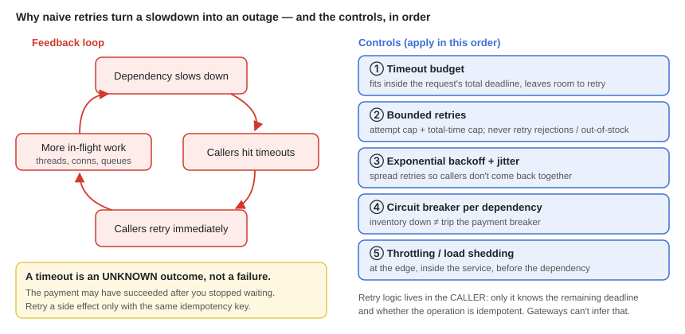

- **超时 ≠ 失败，是“结果未知”**（课程里最值得记的一句）：调用方不等了，下游可能已经扣款。所以**有副作用的调用，超时后能不能重试取决于幂等键 / provider 契约**，不是取决于“超时了”。*"A timeout is an uncertain outcome, not a failure — I only retry a side effect if the provider gives me idempotency."*
- **顺序**：先定**超时预算（timeout budget）**（嵌在整个请求的总 deadline 里，给重试留时间）→ 有上限的重试（次数 + 总时长）→ 指数退避（exponential backoff）+ jitter → **按依赖分开的** circuit breaker（库存挂了不该熔断支付）→ 限流（边缘、服务内、下游前三处）。
- **重试决策放在调用方**：只有调用方知道剩余 deadline 和这个操作是否幂等（idempotent）；网关（gateway）只能做粗粒度的总 deadline / 准入限制，推断不了业务幂等。
- **明确的拒绝永远不重试**：校验失败、支付被拒、鉴权（authorization）失败、**库存不足**（再发一次也变不出库存）。
- **证据对应控制**：错误率看失败、延迟看是否逼近 deadline、**饱和度**（在途请求数、连接数、队列深度、线程耗尽）看调用方是否在堆积。下游请求率在故障中下降 = 熔断（circuit breaking）/限流在起作用，**不等于找到了根因（root cause）**。

### 2.11 Multi-region / Multi-DC <a id="s2-11"></a> [↑ 目录](#toc)

- **要点**：active-passive（简单、RTO 较长）vs active-active（冲突、数据归属）；按用户 home region 路由；全局唯一性需要单一写入点或共识（consensus）；DNS/GSLB 故障切换（failover）；数据驻留（data residency）合规（GDPR、中国数据）。
- **追问**：跨区域（cross-region）一致性？region 故障时正在进行的流程怎么办？

### 2.12 Deterministic Routing / Gradual Rollout <a id="s2-12"></a> [↑ 目录](#toc)

- **要点**：按稳定 key 哈希分桶（bucketing） → 同一用户每次落同一路径（可复现（reproducible）、可审计（auditable））；灰度（gradual rollout / canary）、A/B、切流（traffic shifting）都用同一机制；配置即发布（无需部署）。

### 2.13 Observability <a id="s2-13"></a> [↑ 目录](#toc)

- **要点**：RED（rate/errors/duration）给服务，USE 给资源；分布式 tracing 贯穿异步边界（trace id 写进事件）；**业务指标 ≠ 技术指标**；SLO + error budget；告警按症状不按原因。
- **三种信号回答三个不同问题**（课程补充）：**metrics** = 是否不健康、范围多大、缓解有没有起效（证明不了根因（root cause））；**logs** = 这一跳返回了什么错误（按错误码、依赖、配置版本、release 分组）；**traces** = 一个慢请求的时间花在哪一段（下游 span 变长 vs 新的应用 span）。
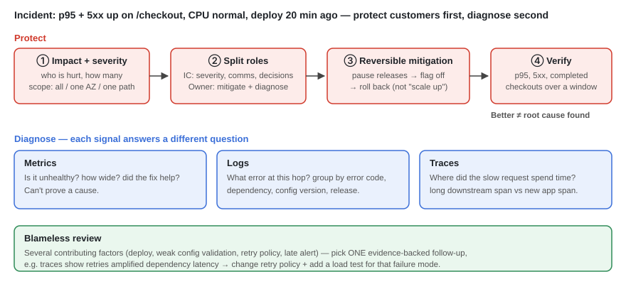

- **事故（incident）前三步**（“dashboard 上 p95 和 5xx 都涨了、CPU 正常、20 分钟前刚发布”）：
  1. **说客户影响 + 定级（severity） + 范围**（全部 region / 某个 AZ / 只有 checkout 路径）。
  2. **分角色**：incident commander 管定级、沟通节奏、决策记录；service owner 管技术止血（mitigation）和诊断。小团队一人兼任也要把两类决定分开说。
  3. **最低风险、可逆的止血**：暂停发布 → 关 feature flag（比整体回滚（rollback）快）→ 回滚；CPU 正常时**不要先假设（assumption）是容量问题**去扩容（scale-out）/限流（rate limiting）。每个止血都配成功判据（p95、5xx、**完成的 checkout 数**观察一段时间）——改善了也只说明止血有效，**不说明根因**。
  - *"First I protect customers: pause releases and flip off the new flag. Then I use logs grouped by release version and traces of slow checkouts to separate 'bad deploy' from 'slow dependency'."*
  - 复盘（retro）：blameless，找**多个**贡献因素（发布、配置校验不足、依赖超时（timeout）、告警阈值），只挑**一个有证据支撑**的 follow-up（如：trace 显示重试放大了依赖延迟 → 改重试策略 + 加对应故障的压测（load test））。接 07 S7 的 RCA 故事。
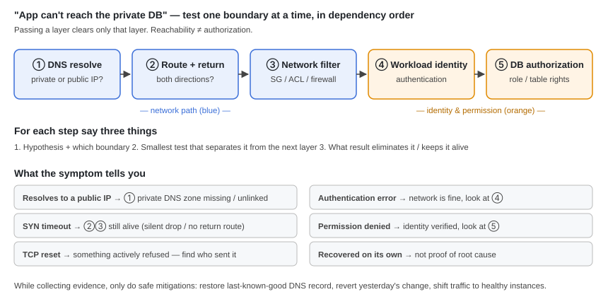

- **逐边界排障法**（课程用“应用连不上私有数据库”做例子，方法通用）：按依赖顺序列假设（DNS 解析 → 路由/回程 → 网络过滤 → workload 身份 → 数据库授权），每步说：**假设、能区分它和下一层的最小测试、预期观察（什么结果排除、什么结果保留）**。信号含义：**SYN 超时** = 路由/过滤/回程都还可能；**TCP reset** = 有东西主动拒绝了，要先找出是谁发的；**认证（authentication）错误** = 网络已通，问题在身份；授权（authorization）拒绝 = 身份已验证但没权限。**排到一层没问题，只排除这一层，不证明后面都对**；收集证据期间只做安全的止血（恢复已知良好的 DNS 记录、回滚昨天的变更、切流到健康实例）。
  - *"A clean private DNS answer is evidence of naming, not of reachability."* / *"Reachability is not authorization."*

### 2.14 Back-of-envelope 速查 <a id="s2-14"></a> [↑ 目录](#toc)

| 常用数 | 值 |
|---|---|
| 1 天 | ≈ 86,400 s ≈ **10^5 s** |
| 1M 请求/天 | ≈ **12 QPS**（均值）；峰值（peak）按 2–5× |
| 100M DAU × 10 次/天 | ≈ 10^9/天 ≈ **12K QPS** |
| 内存访问 / SSD 随机读 / 同 DC RTT / 跨洲 RTT | ~100 ns / ~100 µs / ~0.5 ms / ~100–150 ms |
| 单机 Redis | ~10^5 ops/s 量级 |
| 单 Kafka 分区 | ~MB/s 到数十 MB/s 量级 |
| 单关系库（relational database）主（OLTP） | 千到万级 TPS（视 schema/硬件） |
| 1 KB × 1B 条 | ≈ 1 TB |

**估算（back-of-the-envelope estimate）三条硬规则**（Grokking Modern SD 估算两节，2026-10-26）：

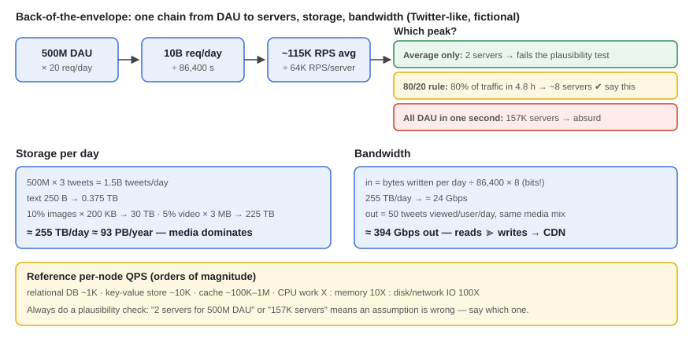

- **峰值别走两个极端**：只用日均 → “5 亿 DAU 只要 2 台机器”，一听就错；假设“所有 DAU 同一秒到达” → 15 万台，也荒谬。**默认用 80/20：80% 流量落在 20% 时间（约 4.8 小时）里**，并说出来这是假设、上线后用监控校正。
- **单节点量级参照**（只记数量级）：关系库 ~1K QPS、KV 存储 ~10K、缓存 10 万–100 万；CPU 活 : 内存活 : IO 活 ≈ 1 : 10 : 100。教学里常用“64 核单机 ~64K RPS”只适合 CPU 密集的极简估算，有 IO 时要打折。
- **带宽 = 每天字节数 ÷ 86,400 × 8**（别忘了字节→比特）；社交/视频类**出网（egress） ≫ 入网（ingress）**（Twitter 例：入 ~24 Gbps、出 ~394 Gbps）——这句话直接推出“必须上 CDN”。
- **每个结果都做合理性检查**：数字离谱时说出是哪条假设错了，而不是改数字凑结果。

**估算练习（假设数字）**：
- 持续 10 QPS = 一天 864K 次——“大量每日请求”不一定是高 QPS，难点（the hard part / crux）往往是**批次集中**和**外部依赖的硬上限**。
- 如果一次性来 500K 个验证，vendor 只有个位数 TPS（~6–10），清空要 **14–23 小时**；内部 pod 扩再多只会制造更多 throttle。所以设计目标是**削峰（load leveling） + 可控消化 backlog**，不是“跑得更快”。（假设值）
- *"I'd translate each stage into completed tasks per second, including calls per task and retries, and compare service, database and vendor capacity. If vendor quota is the binding constraint, adding pods won't increase completion throughput. The forecast alone doesn't identify the measured bottleneck."*

**无状态（stateless）层定容（课程补充，最容易算错的是冗余（redundancy））**——每个数带单位、标明是假设还是实测：

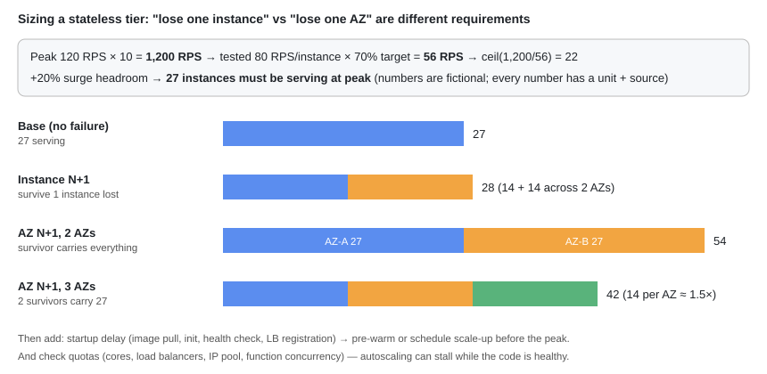

| 步骤 | 例子（虚构数） |
|---|---|
| 峰值 = 均值 × 峰值倍数 | 120 RPS × 10 = **1,200 RPS** |
| 单机容量用**实测值**并附条件（代表性请求组合、p95 ≤ 300 ms 时），不用厂商 benchmark | 80 RPS / 实例 |
| 乘目标利用率（utilization） | 80 × 70% = 56 RPS |
| 实例数 | ceil(1,200 / 56) = **22**；+20% 突发余量（headroom） → **27** |
| 防“丢一台”（实例级 N+1） | **28**，分布在 ≥ 2 个 AZ |
| 防“丢一个 AZ”（**AZ 级 N+1**） | 2 个 AZ 时剩下的那个要扛全部 → **每个 AZ 27 台 = 54**；3 个 AZ 时每个 AZ 要扛 1/2 → 约 1.5× |

- **陷阱**：说“多加一台就能扛 AZ 故障”是错的。*"Surviving a zone loss is a different requirement from surviving an instance loss — with two zones, each zone must carry the full peak."*
- **启动时间决定基线（baseline）**：新实例要拉镜像、初始化、过健康检查、注册到 LB；如果要几分钟，突发流量先到 → 必须**预热（pre-warming）**或按计划提前扩容（scale-out）。扩容粒度大（一次加一台大机器）既会过冲又会慢。
- 需求变了，按这个顺序重算：需求形态 → 实测容量 → 利用率目标 → 冗余要求 → 启动延迟 → 扩容粒度。
- **更多无状态实例不解决共享依赖（shared dependency）的上限**：先找第一个瓶颈（DB 写/锁、热 key、缓存击穿（cache stampede）、第三方限流（rate limiting）、broker 上限），说出要看的指标。隐藏状态（内存 session、本地磁盘上传、长连接（persistent connections））会让负载均衡分不匀、自动扩容（autoscaling）失效。函数计算会**瞬间创建大量连接**，最先打满的往往是 DB / 第三方的连接上限。
- **配额（quota）是被忽略的容量风险**：代码健康但扩容卡住，先怀疑 provider 配额——区域 CPU 核数/实例族、LB 数、**IP 地址池**、函数并发/突发上限。配额有作用域（账号/项目、region），**生产 region 的配额可能比开发 region 小**。做法：上线前查清配额名和作用域 → 提前申请提额并当成上线依赖跟踪 → 容量压测验证能拉起峰值规模；提额来不及 → 预置容量（贵）或多 region 预案（复杂）。*"Before I trust autoscaling, I'd check the regional compute, load-balancer and IP quotas for this account — and if they can't be raised in time, pre-provision."* AI 场景下对应的是模型 provider 的 token / 请求配额（[06 §1.5、§2.8](https://github.com/whicter/AI-Learning-Notes/blob/main/ai_system_design/06-ai-system-design.md)）。
- **成本按业务单位讲**：**每完成一单的成本** = 月成本 / 完成订单数（分母是完成的订单，不是 page view 或支付尝试）。给**低 / 高两档**区间而不是一个数；敏感性最高的通常是：峰值倍数（决定预置容量）、**出网流量**、缓存命中率（hit ratio）、利用率、转化率（conversion rate）（转化率低时每单成本上升，哪怕基础设施用量不变）。计算器结果是“场景估算”，不是账单承诺。

### 2.15 Security & Recovery：身份优先授权 + RTO/RPO <a id="s2-15"></a> [↑ 目录](#toc)

课程第 7 模块的主题。本节原先按通用知识补齐，2026-10-26 读完付费原文后已核对，并补了下面带“课程补充”标记的几条。

- **身份优先授权（identity-first authorization）**：网络位置不等于可信（接 §1.6“信任边界（trust boundary） ≠ 授权”）。每个请求都带身份——用户用 token，服务之间用 **workload identity**（mTLS / 平台签发的服务身份）；**短期凭证（short-lived credentials）**自动轮换（rotation），代替写在配置里的长期密钥；最小权限（least privilege）；**下游服务自己再鉴权一次**，不信任上游“已经检查过了”。
- **RTO / RPO**：RTO = 能停多久；RPO = 能丢多少数据（按时间算）。RPO 由**复制方式**决定（同步复制 ≈ 0，但写延迟更高；异步复制 = 复制延迟（replication lag）那么长）；RTO 由**备用环境有多“热”**决定。
- **DR 四档**（AWS DR 白皮书的常用叫法，跨云通用）：

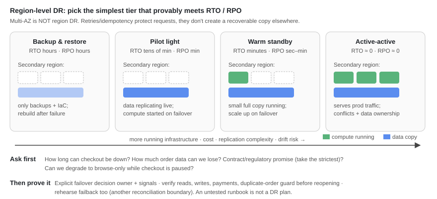

| 档位 | RTO / RPO | 成本 | 什么时候选 |
|---|---|---|---|
| Backup & restore | 小时级 / 小时级 | 最低 | 内部工具、能接受停机 |
| Pilot light（核心数据持续复制，计算按需拉起） | 几十分钟 / 分钟级 | 低 | 多数后台系统 |
| Warm standby（缩小规模的完整副本一直在跑） | 分钟级 / 秒到分钟级 | 中 | 面向用户的核心流程 |
| Multi-site active-active | 接近 0 / 接近 0 | 最高，还要处理冲突与数据归属（§2.11） | 支付、身份等不能停的核心 |

- **证据**（接 §1.6 习惯 2）：**定期恢复演练（drill）**——没恢复过的备份不算备份；failover 演练要实测 RTO 和 RPO，不能拿配置值当结果。
- **课程补充**：
  - **授权按“谁 → 对什么 → 能做什么 → 在什么条件下”说**，每条箭头旁边写一个身份：人类管理员（联邦登录，只对某个环境有配置权限）、API workload → 订单服务（只能“提交订单”，不能删除）、订单服务 → DB（只读写订单表）。用户身份在网关验 JWT，下游按 claims 做**资源级**授权（只能看自己的订单）。*"It's in a private subnet, so it's secure?" → "A private subnet limits paths; identity and policy decide permission."*
  - **凭证分两条路**：第一方云 API 用 workload identity（短期、自动轮换、审计（audit）好）；**第三方 token**（如物流/vendor API key）对方验不了你的云身份 → 放 secrets manager，只允许这个服务的身份读取，轮换后服务要**重新加载或 fail closed**。两条路分开，才能单独撤销云权限或单独轮换第三方 token。证据：云审计日志、secret 读取日志、资产清单里还有没有长期 key。
  - **多 AZ ≠ region 级 DR**：AZ 是同一 region 内的故障域（failure domain）。retries 和幂等（idempotent）只保护单个请求，**不会产生一份可恢复的数据，也不会把流量切到别的 region**。
  - **先问 RTO/RPO 再选档**：能停多久？能丢多少订单/支付/库存数据？有没有合同或监管承诺（取最严的）？**能否先降级（graceful degradation）为“只读浏览”而 checkout 暂停？** 然后选**能被证明满足目标的最简单一档**。
  - **failover 要有显式决策点**（谁根据哪些健康信号宣布 region 故障）；切回后验证 catalog 读、checkout 写、支付集成、防重复下单再开放 checkout；**failback（切回主 region）也要演练**，它是另一个数据对账（reconciliation）边界。
- **用指标驱动事故处理**：按症状告警（SLO burn rate），先止血（回滚（rollback）、切流、降级）再找根因（接 §2.13）。
- *"I'd pick the DR tier from the business's RTO and RPO, not the other way round. For the checkout path that's probably warm standby; for internal tooling, backup and restore is fine — and either way I'd trust it only after a restore drill."*

### 2.16 迁移：分批（wave）、切换标准、回滚触发 <a id="s2-16"></a> [↑ 目录](#toc)

> 来源：课程 *Migration Waves, Cutover Criteria, and Rollback Triggers*（2026-10-26）。原题是“上云”，但方法适用于任何**有状态迁移（stateful migration）**——支付 provider 换成自建、旧系统换新平台、数据库换引擎。§1.1 “演进”一行要求的“如何无停机迁移”就用这个答。

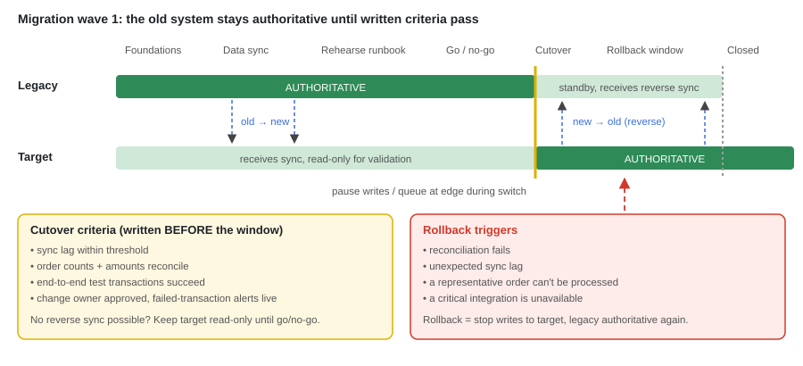

- **先问截止日期是谁定的**（租约（lease）/合同硬约束（hard constraint），还是偏好？），成功怎么度量，**能停多久、能丢多少**（“零订单丢失”直接决定切换方式），有没有监管约束、团队有多少人能值班（on-call）。
- **依赖发现**：上游入口、下游履约/财务、定时批处理、身份提供方、网络路径、文件传输、通知、其他读这个库的消费者。每个依赖记：owner、数据流向、认证方式、敏感度、断掉的影响、怎么测。
- **按组件选策略，不要一刀切**：rehost（原样搬，最快、回滚（rollback）简单）/ replatform（小改用托管能力）/ refactor（深改，最慢、回滚最难）/ retire（下线没人用的集成）/ retain（暂时保留）。截止日期固定时，**为了“现代化”而 refactor 是在加交付和回滚风险**——只有被约束逼到（OS 不再支持、现设计满足不了可用性）才改。
- **Wave 1 = 能碰到真实依赖的最小范围**，用来证明迁移方法本身。顺序：基础就绪（权限、网络、日志监控、备份）→ 数据同步（频率由 RPO 决定）→ **旧系统保持权威**直到通过标准 → 用代表性订单/消息/身份流程**彩排 runbook** → 切换（cutover） → 切换后验证。
- **切换标准（cutover criteria）和回滚触发（rollback triggers）要在窗口开始前写好**：
  - 切换标准：同步延迟（sync lag）在阈值内、订单数和金额对账（reconciliation）一致、端到端（end-to-end）测试交易成功、变更 owner 已批准、失败交易告警已就绪。
  - 回滚触发：对账失败、同步延迟异常、代表性订单处理不了、关键集成不可用。
- **零丢单下的回滚**：切换窗口内暂停写入或在边缘排队；回滚 = 停止写新系统、恢复旧系统为权威路径。**新系统切换后接的单不能丢** → 回滚窗口内保持**反向同步（reverse replication）**（新 → 旧）；做不到反向同步，就在 go/no-go 之前让新系统只读，保证没有“只存在于新系统”的订单。
- *"If dependency mapping confirms the foundations and critical integrations are ready, we migrate a limited slice first, keep the legacy system authoritative, rehearse, and cut over only after reconciliation and end-to-end tests pass. We roll back on data-integrity, critical-transaction or sync-lag triggers — and we keep reverse replication until the rollback window closes."*

### 2.17 从真实大事故学到的设计教训（Staff 加分素材） <a id="s2-17"></a> [↑ 目录](#toc)

> 来源：Grokking *Modern System Design Interview* 的 “Lessons from System Failures” 三节（2026-10-26），基于公开的事后报告。面试里被问“what can go wrong / how would you make this resilient”时，引一个真实事故比空讲更有说服力。

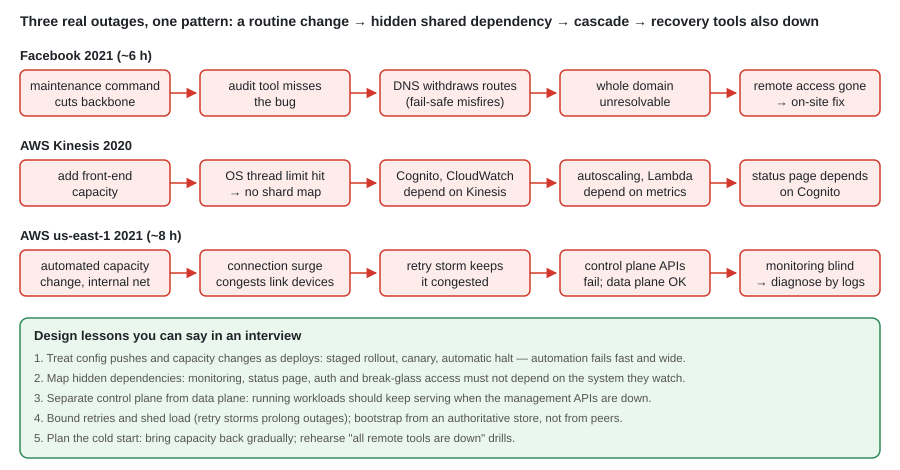

| 事故 | 一句话经过 | 要带走的设计点 |
|---|---|---|
| Facebook 2021（约 6 小时） | 一次评估容量的维护命令把所有 DC 从骨干网断开；审计工具没拦住；DNS 服务器连不上 DC 就按“保护机制”撤回自己的路由 → 全球解析不到 | **自动化 + 配置推送（config push）是最大的故障域（failure domain）**（呼应 §1.6）；保护机制在“全部同时失联”的边界条件下反而致命；远程运维工具依赖同一网络 → 只能派人进机房 |
| AWS Kinesis 2020 | 给前端集群加机器 → 超过 OS 线程上限 → 分片（sharding）映射建不起来；Cognito、CloudWatch 依赖它，自动扩容（autoscaling）和 Lambda 又依赖 CloudWatch，状态页还依赖 Cognito | **扩容（scale-out）本身就是一次变更**，要灰度（gradual rollout / canary）；启动时从权威存储读元数据，不要从同伴节点读；关键服务给独立的前端集群做隔离 |
| AWS us-east-1 2021（约 8 小时） | 内部网络的自动扩容引发连接风暴 → 链路设备拥塞 → **激进重试（retry）让拥塞持续** → 控制面（control plane） API 失败（已在跑的实例正常），监控数据也传不出来 | **控制面和数据面（data plane）分离**；有界重试 + 削峰（§2.10）；监控链路不能和被监控系统共用同一条路 |

**可以直接说的五条**：
1. 配置推送、容量变更都按发布（release）对待：分阶段、金丝雀（canary）、异常自动停。 / EN: "Treat config pushes and capacity changes as releases: staged, canaried, auto-halt on anomalies."
2. 画出隐藏依赖（hidden dependency）：监控、状态页、认证、紧急登录通道（break-glass）**不能依赖它们要观察的系统**。 / EN: "Map hidden dependencies: monitoring, status pages, auth and break-glass access must not depend on the system they observe."
3. 控制面（control plane）挂了，数据面（data plane）要能继续服务（已运行的工作负载不受管理 API 影响）。 / EN: "If the control plane is down, the data plane keeps serving."
4. 有界重试 + 削峰（load leveling），否则重试风暴（retry storm）会延长事故；节点启动从权威存储引导。 / EN: "Bounded retries plus load leveling, or a retry storm prolongs the outage; nodes bootstrap from the authoritative store."
5. 计划冷启动（cold start）：容量逐步恢复，防止回来时被积压流量再次打垮；演练“所有远程工具都不可用”的场景。 / EN: "Plan the cold start: restore capacity gradually so the backlog doesn't knock it over again, and drill the 'no remote tools' scenario."

- *"The pattern in most large outages is the same: a routine change, a hidden shared dependency, then the tools you need to recover depend on the thing that's down. So I'd ask of this design: what does our monitoring and our rollback path depend on?"*


### 2.18 Kafka 机制层追问 10 题（消息队列八股的 Staff 答法） <a id="s2-18"></a> [↑ 目录](#toc)

> 来源：小红书「Kafka面试 Top10 真题，背完再去面试。」（运维面试系列 30，5 页图文，2026-11-04 读；首屏无评论）。原帖每题只有一句话 + 一个配置项，有几处过时或说错。这里每题给：**一句话答案 → Staff 要补的机制 → 原帖要改的地方 → 英文**。SD 轮里 Kafka 通常不单独考，而是在你画了 Kafka 之后被追问，[§1.1](#s1-1) 的“深度”一行要的就是这一层。

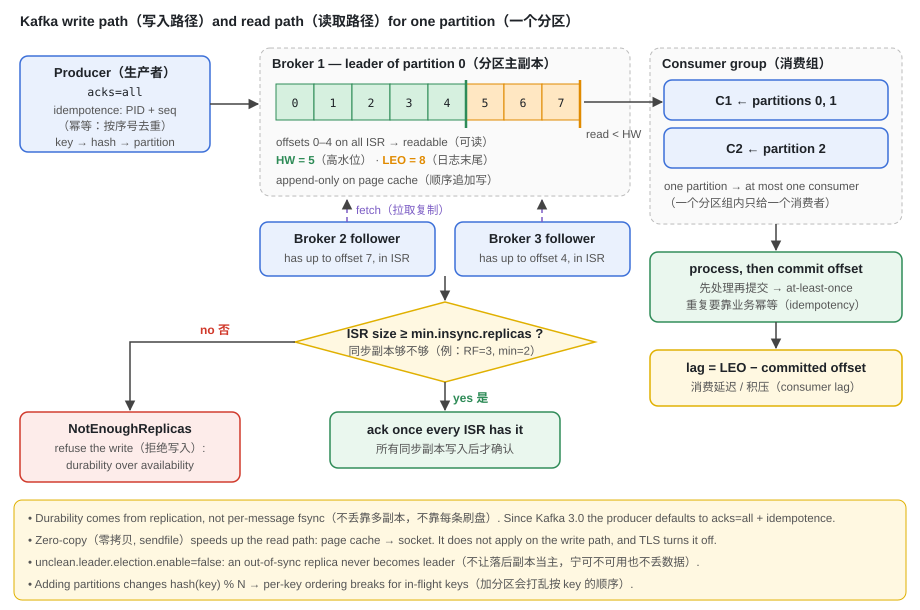

**1. 架构（architecture）**
- 一句话：生产者（producer）把消息按 key 哈希写到主题（topic）的某个分区（partition）的主副本（leader）；从副本（follower）主动拉取（pull）复制；消费组（consumer group）里每个分区只分给一个消费者，按 offset 顺序拉取。
- 补充：元数据和控制器（controller）现在由 **KRaft** 管，**Kafka 4.0 起彻底去掉了 ZooKeeper**。还在背“ZooKeeper 管选举”会显得过时。
- EN: *"Producers hash the key to a partition and write to its leader; followers pull from the leader; within a consumer group each partition goes to exactly one consumer, which reads by offset."*

**2. 为什么是日志（log）而不是队列（queue）**
- 一句话：消息读完不删，按保留期（retention）删除。所以能回放（replay），多个消费组各自记 offset、互不影响。
- 补充：除了按时间/大小删除，还有**日志压缩（log compaction）**：每个 key 只留最新一条，适合当“最新状态表”（例如配置、用户资料的变更流）。代价是日志没有工作分发队列的单条确认和单条重试。Kafka 4.x 在推进 share groups（KIP-932，像队列一样多个消费者共享一个分区），提一句即可，别说它已经成熟。
- EN: *"It's a retained log, not a delete-on-read queue, so any group can replay from an old offset. The trade-off is that per-message acknowledgement and retry are things I build on top."*

**3. 分区（partition）的作用**
- 一句话：分区是并行度和顺序的单位：**同一分区内有序（ordered），跨分区无序（unordered）**；组内消费者数超过分区数，多出来的空闲。
- 补充：分区数要按“目标吞吐 ÷ 单个消费者吞吐”估，再留余量。分区多的代价：每个分区都有文件句柄、副本复制和主副本选举成本，broker 挂掉时恢复更慢。
- **原帖要改**：“partition 越多并行度越高”只对一半——超过消费者数量后不再提高，而且**事后加分区会打乱按 key 的顺序**（见第 7 题）。所以分区数应该一开始就按峰值留够。
- EN: *"Partitions are the unit of both parallelism and ordering. I size them up front from peak throughput, because adding partitions later remaps keys and breaks per-key ordering."*

**4. 主副本选举（leader election）和 ISR**
- 一句话：每个分区有一个主副本和若干从副本；**ISR（in-sync replicas，同步副本集合）**是跟上主副本的那些副本，落后超过 `replica.lag.time.max.ms` 就被踢出。主副本挂了，只从 ISR 里选新的。
- 补充：**高水位（HW, high watermark）**= 所有 ISR 都已经有的位置，消费者只能读到高水位以下，所以换主之后已读的数据不会消失。`unclean.leader.election.enable=false`（默认）：ISR 全挂时宁可分区不可用，也不让落后副本当主而丢数据——这是一个**可用性 vs 不丢数据**的取舍，要能说出来。
- EN: *"Only in-sync replicas can become leader, and consumers only read below the high watermark, so a failover never un-reads data. Disabling unclean election picks durability over availability."*

**5. 为什么写入快**
- 一句话：顺序追加写（append-only）+ 操作系统页缓存（page cache）+ 批量（batching）和压缩（compression）。
- **原帖要改**：原帖把**零拷贝（zero-copy, `sendfile`）**算进“写入快”，不对。零拷贝用在**读路径**：broker 把页缓存里的数据直接发给网卡，不经过用户态，省掉两次内存拷贝。而且**开了 TLS 就用不上**，因为加密（encryption）必须在用户态做。面试官很爱追这一点。
- EN: *"Writes are fast because they're sequential appends into the page cache, batched and compressed. Zero-copy helps the read path, sending page-cache data straight to the socket — and it's lost once you enable TLS."*

**6. 消费组（consumer group）和重平衡（rebalance）**
- 一句话：组内成员增减、或者消费者处理太慢没按时 poll，都会触发分区重新分配。
- **原帖要改**：“Rebalance 全组停消费”是旧的**急切式（eager）**协议。现在有：**协作式增量重平衡（cooperative incremental rebalancing）**，只迁移需要动的分区，其余照常消费；**静态成员（static membership, `group.instance.id`）**，滚动重启不触发重平衡；**新的消费组协议（KIP-848，Kafka 4.0 正式可用）**，分配改由 broker 端协调。
- 补充：最常见的“重平衡风暴”根因是单条处理太慢，超过 `max.poll.interval.ms`，消费者被判死、踢出、再加入，循环往复，积压越来越多。修法是缩小每次 poll 的条数（`max.poll.records`）或把重活移出 poll 循环，而不是一味调大超时。
- EN: *"With cooperative rebalancing and static membership, a rolling deploy doesn't stop the whole group. The rebalance storms I'd actually worry about come from slow processing exceeding max.poll.interval.ms."*

**7. 消息积压（consumer lag）怎么排查**
- 一句话：看 lag（= 日志末尾 offset − 已提交 offset）的**形状**，而不只是总数。
- 补充（按形状分支）：
  - **所有分区都在涨** → 消费吞吐不够：处理逻辑太重、下游（DB / 外部 API）变慢，或者消费者数量已经到分区上限。
  - **只有一两个分区在涨** → 热点 key（hot key）或数据倾斜（skew）；或者**一条毒消息（poison message）**反复失败卡住了这个分区，要有重试上限 + 死信主题（DLT, dead-letter topic）。
  - **lag 锯齿状、伴随频繁重平衡** → 见第 6 题的重平衡风暴。
- **原帖要改**：“分区不够加 partition”有两个前提：消费者数量真的到了上限；能接受**按 key 顺序被打乱**（老 key 映射到新分区，新旧消息可能被不同消费者并发处理）。更稳的办法往往是在分区内按 key 并行处理，或先修下游的慢。
- EN: *"I look at the shape of lag. If every partition grows, consumers or the downstream are too slow; if one partition grows, it's a hot key or a poison message. Adding partitions is a last resort, since it remaps keys and breaks ordering."*

**8. Exactly-once 怎么实现**
- 一句话：**幂等生产者（idempotent producer）**用 producer ID + 每分区序号，让生产者重试不会写出重复；**事务（transactions）**让“消费 → 处理 → 写回 Kafka”的输出和 offset 提交一起成功或一起失败，下游消费者要设 `isolation.level=read_committed`。
- 补充：Kafka 的 exactly-once **只管 Kafka 到 Kafka**。只要处理里有写数据库、调支付这类外部副作用（side effect），就回到 at-least-once + 业务幂等：把 offset 和结果写在同一个数据库事务里，或用业务键 / `(topic, partition, offset)` 去重（见 [§2.5](#s2-5)）。
- EN: *"Kafka's exactly-once covers read-process-write inside Kafka. The moment there's an external side effect, I'm back to at-least-once delivery with an idempotent write on my side."*

**9. 为什么不要建太多 topic**
- 一句话：真正的成本单位是**集群里分区的总数**：元数据、文件句柄、副本复制、换主时间都随它增长；topic 只是分区的分组。
- **原帖要改**：“大 topic 加分区优于多 topic”不能一概而论。要隔离的东西（不同保留期、不同权限、不同 SLA、多租户（multi-tenancy））就该分 topic；同类数据别按用户或按天拆成大量小 topic。KRaft 之后单集群能承载的分区数比 ZooKeeper 时代高很多，但具体上限要按版本和硬件压测，别背数字。
- EN: *"What costs us is total partition count, not topic count. I split topics where retention, access or SLA differ, and never create a topic per user."*

**10. 怎么保证不丢数据**
- 一句话：三段都要配，缺一段就会丢：
  - **生产者**：`acks=all`（**Kafka 3.0 起已是默认**，幂等也默认开启）。
  - **broker**：副本数 3 + `min.insync.replicas=2` + 禁止 unclean 选举。只设 `acks=all` 不设 `min.insync.replicas` 是常见坑：ISR 缩到只剩主副本时，`acks=all` 等于 `acks=1`。
  - **消费者**：**先处理、再提交 offset**（关掉自动提交，或确保自动提交发生在处理之后），重复由业务幂等兜住。
- 补充：Kafka 默认**不对每条消息做 fsync**，不丢靠的是多副本落在不同机架 / 可用区（AZ），而不是刷盘。所以副本要跨故障域（failure domain）摆放。
- 取舍：`acks=all` + `min.insync.replicas=2` 的代价是写延迟变高，并且 ISR 不足时**拒绝写入**——用可用性换不丢数据。
- EN: *"No data loss needs all three hops: acks=all on the producer, replication factor three with min.insync.replicas two and no unclean election on the broker, and commit-after-process on the consumer. Durability comes from replicas in different zones, not from fsync."*

<small>📖 名词解释</small>
<small>

- **分区（partition）**：一个主题被切成的多段日志，每段内有序，可分布在不同机器上并行处理。
- **offset（偏移量）**：消息在分区里的序号。消费者记住自己读到第几号，就能断点续读或回放。
- **ISR（in-sync replicas，同步副本集合）**：跟得上主副本的副本名单。只有名单里的副本能被选为新的主副本。
- **高水位（HW, high watermark）**：所有同步副本都已经写入的位置，消费者只能读到这里之前。
- **LEO（log end offset，日志末尾偏移）**：主副本日志里下一条消息将要用的序号。
- **`acks`**：生产者要等几个副本确认才算写成功。`all` = 所有同步副本都写入。
- **`min.insync.replicas`**：同步副本至少要有几个，写入才被接受，不够就报错拒写。
- **unclean 选举（unclean leader election）**：允许不在同步名单里的落后副本当主副本，会丢掉它没跟上的数据。
- **零拷贝（zero-copy）**：数据从磁盘缓存直接交给网卡，不复制到应用程序内存里，省 CPU。
- **重平衡（rebalance）**：消费组成员变化时，重新分配“哪个消费者读哪个分区”。
- **日志压缩（log compaction）**：每个 key 只保留最新一条的保留策略。
- **KRaft**：Kafka 自带的元数据共识协议（基于 Raft），取代 ZooKeeper。
- **毒消息（poison message）**：每次处理都会失败的消息，不跳过就会一直卡住它所在的分区。
- **死信主题（DLT, dead-letter topic）**：重试到上限仍失败的消息转存到这里，等人工或单独流程处理。
</small>

---

## 3. 题库 <a id="s3"></a> [↑ 目录](#toc)

标 ★ 的 8 题有完整拆解（3.1–3.8）；其余在 3.9–3.10 给关键点。建议顺序：先练领域相近题（自信、有真实例子），再补经典 C 端题（大厂高频，你的短板）。

| # | 题目 | 类型 | 优先级 |
|---|---|---|---|
| 1 | ★ Rate Limiter（分布式） | 经典 | 高 |
| 2 | ★ Notification System | 经典 | 高 |
| 3 | ★ Payment System & Ledger | 领域 | 最高 |
| 4 | ★ KYC / Identity Verification Platform | 领域（你的） | 最高 |
| 5 | ★ Workflow Orchestration / Distributed Job Scheduler | 领域/经典 | 最高 |
| 6 | ★ Webhook Delivery Platform | 领域 | 高 |
| 7 | ★ Feature Flag & Dynamic Config Platform | 领域 | 高 |
| 8 | ★ News Feed | 经典 | 高（Meta 必练） |
| 9 | URL Shortener | 经典 | 中（热身） |
| 10 | Chat / Messaging（WhatsApp/Slack） | 经典 | 高 |
| 11 | Distributed Cache | 经典 | 中 |
| 12 | Search Autocomplete / Typeahead | 经典 | 中 |
| 13 | File Storage & Sync（Dropbox） | 经典 | 中 |
| 14 | Metrics & Monitoring（Datadog） | 经典 | 中 |
| 15 | Ticketing / Booking（Ticketmaster） | 经典 | 高（并发库存 / concurrent inventory） |
| 16 | Distributed Key-Value Store | 经典 | 中 |
| 17 | Web Crawler | 经典 | 低 |
| 18 | Top-K / Leaderboard（完整版 [§3.12](#s3-12)） | 经典 | 中 |
| 19 | Fraud / Risk Rules Engine | 领域 | 高 |
| 20 | Audit Log Service | 领域 | 中 |
| 21 | Multi-tenant Compliance-as-a-Service | 领域 | 中 |
| 22 | Idempotency-Key Service / Unique ID Generator | 领域 | 中 |
| 23 | Periodic Re-verification Scheduler（批量到期） | 领域（你的） | 高 |
| 24 | Large-scale ETL / Data Pipeline | 领域（Walmart） | 中 |
| 25 | Inventory Management / Reservation | 领域 | 中 |
| 26 | Ad Click Aggregation（流式聚合） | 经典 | 中 |
| 27 | Proximity / Ride-hailing（Yelp、Uber） | 经典 | 中（地理索引 / geospatial index） |
| 28 | Video Streaming（YouTube） | 经典 | 中 |
| 29 | Collaborative Editing（Google Docs） | 经典 | 中（OT/CRDT） |

---

### 3.1 ★ Distributed Rate Limiter <a id="s3-1"></a> [↑ 目录](#toc)

**需求（requirements）**：按 user / API key / IP 限流（rate limiting）；多规则（每秒 + 每天）；分布式（N 个网关（gateway）实例）；延迟（latency） <1–2 ms 额外开销；限流服务挂了要**fail-open 还是 fail-closed** 必须明确。

**API**
```
allow(key, rule_id, cost=1) -> {allowed: bool, remaining, retry_after_ms}
HTTP: 429 + Retry-After + X-RateLimit-Remaining
```

**数据模型**：`rule(rule_id, scope, limit, window, algorithm)`；计数状态 `bucket:{rule}:{key} -> (tokens, last_refill_ts)` 存 Redis。

**架构**
```
Client → API Gateway (limiter middleware, local rules cache)
              │  Lua script (atomic refill+consume)
              ▼
        Redis Cluster (sharded by key)      Rules Service → push config
              │
        (async) metrics: allowed/denied per rule
```

**深挖（deep dive）**
- 算法：token bucket（允许突发，最常用）vs sliding window log（精确（exact）但耗内存）vs sliding window counter（近似（approximate）、省内存）。
- 原子性（atomicity）：Redis Lua 脚本里完成 refill + consume，避免 race。
- 性能：每次请求一次 Redis RTT；超高 QPS 时用**本地预取配额（quota）**（每个实例批量领取 token，牺牲精度换延迟）。
- 热 key（hot key）：单个大客户打爆一个 Redis 分片（sharding） → 本地限流前置 + key 拆分。
- 故障：Redis 不可用 → 通常 fail-open（保可用）+ 本地粗粒度兜底（fallback / safety net）；对**保护付费下游（downstream）**的场景应 fail-closed。

**Tradeoff 句**：*"Exact global accuracy costs a network round trip per request. For abuse protection, approximate is fine, so I'd let each gateway lease tokens in small batches."*

**Staff 扩展**
- 区分**入口限流**（保护自己）和**出口限流**（保护下游 vendor，必须集中/持久化（persisted））。
- 背压（backpressure）：有界队列（bounded queue） + 拒绝，让过载可见。

---

### 3.2 ★ Notification System（push / email / SMS / in-app） <a id="s3-2"></a> [↑ 目录](#toc)

**需求**：多渠道（multi-channel）；模板（templates）与本地化（localization）；用户偏好（preferences）与退订（unsubscribe）；优先级（交易类 > 营销类）；**至少一次投递（at-least-once delivery） + 去重（dedupe）**；定时/批量发送；第三方 provider 限流（rate limiting）与故障切换（failover）。

**API**
```
POST /notifications {idempotency_key, user_id, template_id, params, channels?, priority, send_at?}
GET  /notifications/{id}/status
PUT  /users/{id}/preferences
```

**数据模型**：`notification(id, idempotency_key UNIQUE, user_id, template, status, created_at)`；`delivery_attempt(notification_id, channel, provider, status, attempt_no, provider_msg_id)`；`user_pref(user_id, channel, category, opted_in)`。

**架构**
```
Producers ─► Notification API ─► (dedupe on idempotency_key) ─► DB
                                     │
                                     ▼
                         Priority queues (high / bulk)
                                     │
              ┌──────────────┬───────┴───────┬──────────────┐
          Push worker    Email worker    SMS worker    In-app worker
              │               │               │
         APNs/FCM      Email providers   SMS providers (per-provider rate limit,
                                                         circuit breaker, failover)
                                     │
                     Provider callbacks (delivered/bounced) → status update
```

**深挖**
- 去重：API 层幂等键（idempotency key）唯一约束（unique constraint）；worker 层“已发送”状态条件更新（conditional update），防重复发。
- 优先级隔离（priority isolation）：交易类与营销类**分队列分 worker 池**，营销洪峰不饿死交易通知（批量与实时使用不同消费组（separate consumer groups）同理）。
- 外部 provider：每家独立限流和熔断（circuit breaking）；按 hash 或权重分流、故障切换（failover）。
- 定时发送：延迟队列（delay queue） / 按分钟分桶（bucketing）的调度表；避免整点惊群（thundering herd）加 jitter。
- 偏好/合规（compliance）：发送前最后一刻检查退订（不是入队时）。

**Staff 扩展**：送达率与延迟 SLO 分类别；模板版本化（template versioning）与审核；“通知”与“业务状态”解耦（decouple）——**邮件发送成功不代表任务状态正确**（你的第 14 章观点）；成本（SMS 昂贵）→ 渠道降级（graceful degradation）策略。

---

### 3.3 ★ Payment System & Ledger（最高优先，领域最近） <a id="s3-3"></a> [↑ 目录](#toc)

**需求**：用户付款 → 调用 PSP 扣款（charge） → 记账 → 卖家结算（settlement）/打款（payout）；**不能重复扣款、不能丢钱**；对账（reconciliation）；退款；多币种（可砍）；审计（audit）。非功能（non-functional）：正确性 >> 延迟；可用性（availability）高但宁可失败也不重复扣。

**API**
```
POST /payments {idempotency_key, payer_id, payee_id, amount, currency, method_token}
     -> {payment_id, status: PENDING|SUCCEEDED|FAILED|REQUIRES_ACTION}
POST /payments/{id}/refunds {idempotency_key, amount}
GET  /payments/{id}
PSP webhook: POST /psp/callbacks
```

**数据模型**
- `payment(id, idempotency_key UNIQUE, status, amount, currency, psp_ref, version)` — 状态机（state machine）：`CREATED → AUTHORIZING → AUTHORIZED → CAPTURED → SETTLED`，分支 `FAILED / REFUNDED`。
- **复式账本（double-entry ledger）** `ledger_entry(id, txn_id, account_id, amount(+/-), currency, created_at)`，**append-only**，每个 txn 借贷和为 0。余额 = 物化视图（materialized view）/定期快照（snapshot） + 增量。
- `outbox(id, aggregate_id, event_type, payload, published_at)`。

**架构**
```
Client ─► Payment API ─(idempotency check)─► Payment Service ──► PSP (Stripe/Adyen…)
                                  │   local txn: payment row + outbox row
                                  ▼
                         Outbox relay / CDC ─► Event bus
                                  │
               ┌──────────────────┼────────────────────┐
           Ledger Service    Payout Service      Notification
          (double-entry,     (scheduled, KYC
           append-only)       gate before payout)
                                  │
                  Reconciliation job: our ledger vs PSP settlement files vs bank
```

**深挖**
- **幂等（idempotent）**：客户端幂等键（idempotency key） + 服务端存“键 → 请求指纹 + 最终响应”；同键不同参数 → 409。调用 PSP 也带幂等键（PSP 侧去重）。
- **未知结果**：PSP 超时（timeout） ≠ 失败。状态置 `UNKNOWN`，用 PSP 查询接口（status query API）/回调（callback）/对账收敛，**绝不盲目重试（retry）扣款**。
- **双写（dual write）**：payment 状态与事件用 outbox；ledger 消费者（consumer）按 txn_id 幂等（idempotent）。
- **对账**：每日与 PSP 结算文件、银行流水三方对账，差异进人工队列。这是“最终正确性”的兜底。
- **一致性（consistency）**：同一账户余额更新串行化（serialized）（按 account 分区（partition） / 行锁 / 乐观锁（optimistic locking） version）。
- **风控（risk check）放在调用 PSP 之前，并设计它挂了怎么办**（课程补充）：风控服务报错时不必整单失败——**按金额分级 fallback**：小额放行、接受小风险，大额拒绝或转人工。这是一个明确的风险 vs 体验取舍（trade-off），要说出来。
- **两步扣款（two-step payment）**：authorize（冻结（hold）额度）→ capture（真正扣款），中间可取消；**争议/拒付（chargeback）**单独一个服务和状态分支，不要塞进主状态机。

**Tradeoff 句**：*"I'd rather fail a payment than double-charge, so on an ambiguous PSP timeout we park it in UNKNOWN and reconcile, instead of retrying the charge."*

---

### 3.4 ★ KYC / Identity Verification Platform（你的主场——但按“通用设计题”答） <a id="s3-4"></a> [↑ 目录](#toc)

> 面试官问“Design a KYC system”时，**先按通用题设计**，再在深挖时自然引入真实经验。不要一上来背内部架构。第 4 节讲“设计你做过的系统”的另一种问法。

**需求**：卖家在多个国家注册、按国家/实体类型（entity type）/风险收集并验证身份（个人证件、公司注册、银行账户归属）；多 vendor；人工审核（manual review）；结果决定账户后果（consequence）（限制收款/上架）；周期性复审（periodic re-verification）；政策（policy）频繁变更且需可审计、可回滚（rollback）。非功能：正确性与可审计 > 延迟；外部 vendor 慢且有 TPS 上限；PII 安全。

**API**
```
POST /kyc/submissions {user_id, entity, data, idempotency_key}   -> 202 {case_id}
GET  /kyc/users/{id}/status          -> per-check status + required actions + deadlines
Events in:  PROFILE_CHANGED, ACCOUNT_TYPE_CHANGED, VENDOR_RESULT, REVIEW_DECISION, DEADLINE_REACHED
Events out: KYC_STATUS_CHANGED, CONSEQUENCE_APPLIED
```

**数据模型（核心是把“状态”拆对）**
| 实体 | 表达 |
|---|---|
| `policy_config(market, entity_type, version)` | 要求哪些 check、阈值（thresholds）、期限、后果——**配置而非代码** |
| `requirement(user, check_type, action)` | 当前政策要求做什么（collect / verify / none） |
| `check(user, entity, check_type, state)` | AWAITING_DATA / PENDING_REVIEW / PASSED / FAILED … |
| `verification_case(id, vendor, state, attempts)` | 一次执行：IN_PROGRESS / THROTTLED / COMPLETED |
| `evidence_profile(owner, entity, data_digest, result, provenance)` | 可复用（reusable）证据，绑定身份快照 |
| `consequence(user, type, due_date, state)` | 账户限制及期限 |

**架构**
```
Event bus ─► Intake consumers (filter irrelevant events, isolate batch vs real-time groups)
                 │
                 ▼
          Orchestrator ─► Requirement eval ─► Policy eval (config-driven rules) ─► Action exec
                                                                                     │
                                                    digest dedup ── same? short-circuit
                                                                                     ▼
                                            Verification method svc (202, persistent case state)
                                                                                     │
                                         Vendor gateway (adapters + anti-corruption layer,
                                         deterministic bucket routing, throttle → delayed retry)
                                                                                     │
                                                         Vendors / Manual review queue
                                                                                     │
                       VENDOR_RESULT → evidence profile → re-evaluate policy → check/consequence
```

**深挖（选 2–3 个）**
1. **配置驱动（config-driven）的政策**：维度 = 国家 × 站点分类 × 法律实体 × 法规（regulation）实体 × tier/版本；共享 evaluator/actions，差异在配置。版本化（versioned），可预览、可回滚。
2. **外部依赖（dependency）与背压（backpressure）**：202 异步（async）接受；持久化（persist） case 状态；vendor 限流（rate limiting） → 落库 + 延迟事件 + 抖动（jitter）退避（backoff）；确定性分桶（deterministic bucketing）做多 vendor 分流/灰度（gradual rollout / canary）/切流（traffic shifting）。
3. **正确性**：至少一次投递 → digest 去重 + 状态守卫（state guard）；后果执行前重读当前状态；区分“技术错误”和“业务未通过”。
4. **周期复审（periodic re-verification）洪峰**：到期日（due date）分散（jitter）、独立 consumer group、按 vendor 容量（capacity）节流消化。
5. **回滚与发布（release）**：政策变更 = 单向门（one-way door）→ 预览模式（preview mode）+ 灰度（canary） + 业务补偿（compensation）式回滚。

**Staff 扩展**：PII（最小权限（least privilege）、加密（encryption）、脱敏（redaction）日志、数据驻留（data residency））；审计（audit；谁、何时、依据哪个政策版本做了什么决定）；人审（manual review）容量作为一等约束（风险分层决定哪些需要人审）；AI 辅助排障（只读工具、证据输出、诊断与修复分离）。

---

### 3.5 ★ Workflow Orchestration Engine / Distributed Job Scheduler <a id="s3-5"></a> [↑ 目录](#toc)

**需求**：定义多步骤工作流（workflow；含等待外部回调（callback）、定时器（timer）、人工步骤）；步骤重试（retry）与超时（timeout）；持久化，可在 worker 崩溃后继续；定时任务（cron）与一次性延迟任务；可观测（每个实例在哪一步）；百万级并发实例。

**API**
```
POST /workflows/{type}/start {workflow_id(idempotent), input}
POST /workflows/{id}/signal {name, payload}       # external event (e.g. vendor callback)
GET  /workflows/{id}                               # current state + history
POST /schedules {cron | run_at, workflow_type, input}
```

**数据模型**
- `workflow_instance(id, type, state, current_step, version, shard)`
- `history_event(workflow_id, seq, type, payload)` — append-only，事件溯源（event sourcing）可重放（replay）
- `timer(fire_at, workflow_id, timer_id)` — 按时间分桶分片（sharding）
- `task_queue(queue_name, task)` — worker 拉取（pull）

**架构**
```
Clients ─► Frontend ─► History service (sharded by workflow_id; owns state + history)
                              │  writes: history + transfer tasks (outbox-like, same txn)
                              ▼
                   Matching service (task queues) ◄── Workers (poll, execute, heartbeat)
                              │
                   Timer service (time-bucketed scan → fire → enqueue)
```

**深挖**
- **持久化执行**：每步完成写 history；worker 崩了，任务超时后重新派发；步骤必须幂等（或外部调用带幂等键（idempotency key））。
- **定时器**：分时间桶 + 分片扫描；海量同时到期 → 加 jitter 或限速消化。
- **分片与所有权**：workflow_id 哈希（hash）到 shard，shard 由单一 owner 处理（租约（lease）/成员协议（membership protocol）），避免并发修改同一实例。
- **背压（backpressure）**：任务队列长度、worker 并发上限；下游受限时降速而不是堆积重试。
- **版本**：工作流定义变更时，在途实例按旧版本继续（版本标记）。
- **按紧急程度分队列（课程补充）**：单个 FIFO 会让长任务堵住紧急任务（队头阻塞（head-of-line blocking））→ 分 urgent / delayable / periodic；每个任务带 **delay tolerance**，调度器优先“容忍度最短”的；**aging**：可延后任务快到容忍上限时提升为紧急，防饥饿（starvation）。
- **执行上限（execution cap）**：超过时限就杀掉、释放槽位、通知提交方（防死循环）；合法的长任务（如训练）要**checkpoint**，被抢占或机器挂了能续跑。
- **多租户（multi-tenant）**：不可信代码进容器/VM 沙箱（sandbox） + 每租户资源上限；可延后任务挪到低峰跑。

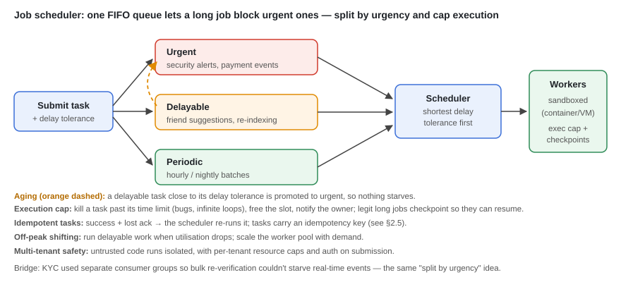

**Tradeoff 句**：*"Build vs. adopt: if the org already runs Temporal or Step Functions, I'd adopt it. The interesting design work is then in step idempotency and in how business state maps onto workflow state — not in rebuilding the engine."*


---

### 3.6 ★ Webhook Delivery Platform <a id="s3-6"></a> [↑ 目录](#toc)

**需求**：向成千上万第三方 endpoint 投递（delivery）事件；至少一次（at-least-once）；按订阅（subscription）过滤；签名（signature）防伪；失败重试（retry）最长 N 天；**慢/坏 endpoint 不能拖垮其他租户**；客户可查看投递日志并手动重放。

**API**
```
POST /subscriptions {endpoint_url, event_types[], secret}
GET  /deliveries?subscription_id=&status=
POST /deliveries/{id}/replay
Outgoing: POST endpoint  headers: X-Signature (HMAC), X-Event-Id, X-Timestamp
```

**数据模型**：`subscription`；`event(id, type, payload, created_at)`；`delivery(id, event_id, subscription_id, status, attempt, next_attempt_at, last_error)`。

**架构**
```
Internal events ─► Fan-out service (match subscriptions) ─► delivery rows + queue
                                                               │
                        Per-endpoint (or per-tenant) queues / partitions
                                                               │
                Dispatcher workers (per-endpoint concurrency cap, timeout, circuit breaker)
                         │ success → mark delivered
                         │ fail → schedule retry (exp backoff + jitter) → after max → DLQ, disable endpoint, notify customer
```

**深挖**
- **隔离**：按 endpoint 分区 + 并发上限，坏 endpoint 只积压自己的队列（noisy neighbor）。
- **顺序**：一般不保证；需要时按 key 串行（代价是吞吐（throughput））。告诉客户用 event_id 去重、用 timestamp/version 处理乱序（out-of-order）。
- **安全**：HMAC 签名 + 时间戳防重放；SSRF 防护（禁止内网地址）；secret 轮换（rotation）双签。
- **重试预算**：指数退避（exponential backoff） + jitter，最长 3 天；熔断（circuit breaking）后定期探测。


---

### 3.7 ★ Feature Flag & Dynamic Config Platform（含 policy-as-config） <a id="s3-7"></a> [↑ 目录](#toc)

**需求**：创建 flag/配置；按用户/百分比/属性定向；秒级生效且**不发布代码**；服务端 SDK 本地求值（local evaluation）（低延迟、控制面（control plane）挂了仍能工作）；审计、审批、回滚（rollback）；配置 schema 校验，防止一个错误配置打挂全站。

**API**
```
Control plane: PUT /flags/{key} {rules, rollout%, variants}  (requires approval for prod)
               POST /flags/{key}/rollback {to_version}
SDK:           evaluate(flag_key, context) -> variant     # in-process, no network
Streaming:     SDK subscribes to config updates (SSE/long-poll)
```

**数据模型**：`flag(key, version, rules_json, status)`；`flag_version(key, version, rules_json, author, approved_by, created_at)`（不可变）；`audit_log`。

**架构**
```
UI/API ─► Control plane (validation, approvals, versioning) ─► Config store (versioned)
                                                                   │ publish
                                                     Distribution (CDN/stream/relay proxies)
                                                                   │
                                Service SDKs (local cache, evaluate in-process, last-known-good on disk)
```

**深挖**
- **确定性分桶**：`hash(flag_key + user_id) % 100` → 同一用户稳定、不同 flag 独立。
- **安全发布**：schema 校验、静态检查、staged rollout（先 1%/一个 region）、自动回滚条件（错误率上升）、**last-known-good**。
- **一致性**：配置最终一致（eventual consistency），几秒传播；需要原子（atomic）切换多个 flag 时用同一版本快照。
- **治理**：谁能改 prod、需几人审批；flag 生命周期（过期清理技术债（technical debt））。


---

### 3.8 ★ News Feed（Meta 高频，你的短板，必须练熟） <a id="s3-8"></a> [↑ 目录](#toc)

**需求**：用户发帖；关注者看到按时间/排序的 feed；分页；规模 ~10^8–10^9 DAU；读远多于写；feed 延迟 <200 ms；新帖可容忍秒级延迟出现。

**估算（back-of-the-envelope estimate）**：500M DAU × 10 次刷新 ≈ 5×10^9 读/天 ≈ 60K QPS 均值、峰值（peak） ~150K+；写 ~5–10K QPS。

**API**
```
POST /posts {content, media_ids}
GET  /feed?cursor=&limit=20
POST /follow/{user_id}
```

**数据模型**：`post(post_id[time-sortable], author_id, content, created_at)` 按 author 分片（sharding）；`follow(follower_id, followee_id)` 双向索引；`feed_cache(user_id → [post_id…])` 存 Redis，只存最近 N 条 ID。

**架构**
```
Post ─► Post Service ─► Post store ─► Fan-out service (async, queue)
                                          │ for normal authors: push post_id into followers' feed caches
                                          │ for celebrities: skip (pull at read time)
Read ─► Feed Service ─► feed cache (precomputed IDs) + merge celebrity posts (pull) ─► rank ─► hydrate (post/user caches) ─► client
```

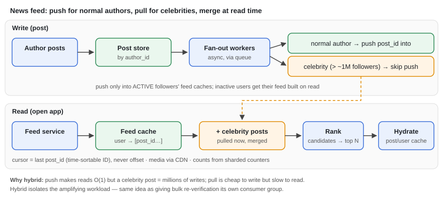

**深挖**
- **Push vs Pull vs Hybrid**：push（fan-out on write）读快但大 V 写放大；pull 写便宜读慢；**混合**：普通用户 push、大 V（如 >1M 粉）读时 pull 合并。
- **只为活跃用户 fan-out**：不活跃用户读时再构建，省存储。
- **分页**：cursor = 最后一个 post_id（时间可排序 ID，如 Snowflake）而非 offset。
- **排序**：候选生成（几百条）→ 轻量排序模型（ranking model）→ 重排（reranking；去重、多样性（diversity））。
- **热点（hot spot）**：大 V 帖子的 hydrate 走多级缓存（cache）。
- **删除/隐私**：读时过滤 + 异步清理 feed cache。

**Staff 扩展**：fan-out 队列积压时的降级（先保证读，延后写入扇出）；cache 冷启动（cold start）；跨 region（feed cache 就近（close to users），post 存储全局复制）；ranking 实验平台；**成本**（feed cache 内存）。


---

### 3.9 经典题关键点（每题 3–5 条） <a id="s3-9"></a> [↑ 目录](#toc)

**9. URL Shortener**（热身题，10 分钟讲完） <a id="sd-9"></a>
- ID 生成：base62(计数器/号段) vs 哈希截断（碰撞处理）；预分配号段（ID segment allocation）避免单点（single point of failure）。
- 读多写少（read-heavy）：重定向走缓存 + CDN；301（可缓存）vs 302（可统计）。
- 自定义别名唯一性：唯一约束；过期清理。
- 分析：点击事件异步入流式管道，不阻塞重定向。

**10. Chat / Messaging** <a id="sd-10"></a>
- 长连接（WebSocket）网关 + 连接注册表（user → gateway 节点）；网关无状态（stateless）可横扩。
- 消息存储：按 conversation_id 分区，会话（conversation）内用单调递增（monotonically increasing）序号保证顺序（Cassandra/HBase 宽行）。
- 投递语义：至少一次 + 客户端按 message_id 去重；已送达/已读回执（receipt）。
- 离线：存储 + 推送通知（push notification）；多设备同步（sync）用每设备游标（per-device cursor）。
- 群聊：小群写扩散（fan-out on write）、大群读扩散（fan-out on read）；在线状态（presence）用心跳（heartbeat） + TTL，懒更新。
- **课程补充（Grokking WhatsApp 三节）**：发送顺序是**先落库、再查注册表转发**——B 离线时消息还在，上线后推送 + 拉取；注册表（user → WS 服务器，Redis）在每台 WS 服务器上**带短 TTL 本地缓存（in-process cache）**，重连到别的服务器就覆盖映射。**媒体不走长连接**：客户端加密 → 资产服务存 blob（内容哈希去重）→ 只把 media_id 当消息发；热门媒体进 CDN。群聊：每个群一个 topic，群消息 handler 查成员后逐个按 1:1 投递。取舍（trade-off）：**顺序 > 可用性**（分区时宁可延迟也不乱序）；端到端加密（end-to-end encryption） vs 延迟（大文件加解密耗 CPU）。

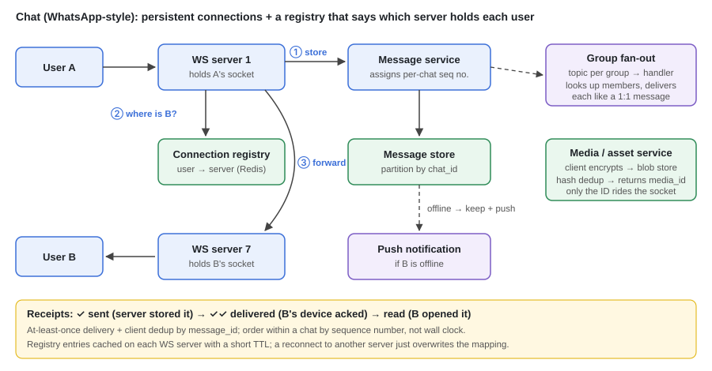

**11. Distributed Cache** <a id="sd-11"></a>
- 一致性哈希（consistent hashing） + 虚拟节点；复制（replication）（主从 / primary-replica）与故障转移。
- 淘汰策略 LRU/LFU；内存碎片；大 value 拆分。
- 热 key：客户端本地缓存 + 副本（replica）读；击穿/雪崩/穿透三件套。
- 一致性：cache-aside + 删除而非更新；延迟双删或 CDC 驱动失效。

**12. Search Autocomplete** <a id="sd-12"></a>
- Trie（或前缀（prefix）→ top-K 预计算表），离线按频次构建、定期刷新。
- 在线：前缀查询走缓存（短前缀命中率极高），浏览器端 debounce。
- 个性化与趋势：离线全局 top-K + 在线实时热词流（滑动窗口（sliding window）计数）合并。
- 过滤：敏感词、多语言、拼写纠错（可砍）。
- **课程补充**：在线路径只读、离线路径重建——查询日志 → 按窗口聚合（带衰减）→ trie builder 出新快照 → **备用副本建好再切换**（不在线上原地改 trie）；每个节点存该前缀的 top-K；按字母范围（range）分片（sharding）会不均（某些首字母热得多）→ 按实测负载切分。

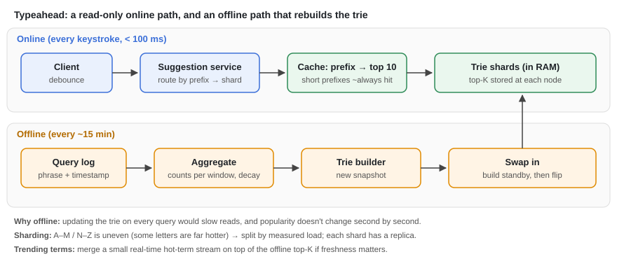

**13. File Storage & Sync（Dropbox）** <a id="sd-13"></a>
- 分块（4 MB）+ 内容哈希去重；只传变化块（delta sync）。
- 元数据（metadata）服务（文件树、版本、块列表，强一致（strong consistency））与块存储（S3 类，最终一致（eventual consistency））分离。
- 同步：客户端长轮询（long polling）/通知服务 + 每设备游标；冲突（conflict） → 生成冲突副本。
- 大文件：分片上传、断点续传（**你的 Veeva 大文件 FTP 经历可桥接**——只说简历层面的事实，细节没材料不要编）。

**14. Metrics & Monitoring** <a id="sd-14"></a>
- 采集：agent push 或 pull（Prometheus）；高基数（high cardinality）标签是成本杀手。
- 存储：时序数据库（time-series database；按 metric+tags 分片、按时间分块、压缩（compression）Gorilla 编码（encoding））；降采样（downsampling） + 冷热分层（hot/cold tiering）。
- 查询与告警（alerting）：告警规则引擎（rules engine）独立于查询路径；告警按症状（SLO burn rate）。
- 可靠性（reliability）：监控系统本身要比被监控系统更可用；meta-monitoring。

**15. Ticketing / Booking（Ticketmaster）** <a id="sd-15"></a>
- 核心难点（the hard part / crux）：**并发抢同一库存** → 座位级行锁/条件更新，或 Redis 原子扣减 + 异步落库。
- 临时预留（hold）+ TTL（10 分钟），超时（timeout）释放；支付成功才确认。
- 洪峰：虚拟排队（waiting room）在入口削峰（load leveling），令牌（token）放行。
- 防超卖（overselling）与幂等（idempotent）下单；支付与预留之间用 saga（支付失败释放座位）。
- **“AVAILABLE → HELD” 怎么保证独占**（课程补充，三选一要能比较）：乐观锁（version / 条件 UPDATE，不阻塞，热座位输家多）· 悲观锁（pessimistic locking；行锁 / `SELECT … FOR UPDATE`，无冲突但同一行排队）· 分布式锁（Redis/ZooKeeper，跨分片可用，需租约 + fencing token）。默认答：**在拥有座位数据的库里做条件更新**，等候室（waiting room）把竞争控制在可承受范围。

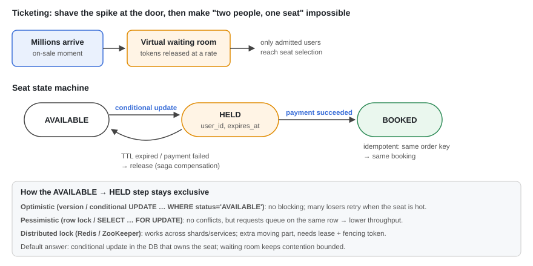

**16. Distributed Key-Value Store（Dynamo 风格）** <a id="sd-16"></a>
- 一致性哈希分区 + N 副本；quorum R/W 可调。
- 冲突：向量时钟（vector clock）或 LWW；读修复（read repair） + 反熵（Merkle tree）。
- 成员管理（membership）：gossip；故障检测（failure detection）；hinted handoff。
- 存储引擎：LSM（写优化）vs B-tree（读优化）。

**17. Web Crawler** <a id="sd-17"></a>
- URL frontier：优先级队列（priority queue） + **按域名礼貌限速**（per-host 队列）。
- 去重：URL 规范化（normalization） + Bloom filter；内容指纹（simhash）去近似重复。
- 分布式：按域名哈希分配给 worker，保证同域礼貌性；robots.txt 缓存。
- 陷阱：无限 URL 空间、爬虫陷阱 → 深度/数量上限。

**18. Top-K / Leaderboard** <a id="sd-18"></a>
- **完整答法（流式管道图、精确 vs 近似、滑动窗口、热点、重算、追问英文回答）见 [§3.12](#s3-12)**；下面是一句话版。
- 实时：Redis sorted set（单榜）；超大规模按分片局部 top-K 再合并。
- 流式近似：Count-Min Sketch + 小顶堆（min-heap）；滑动窗口（sliding window）用时间分桶。
- 精确离线：批处理（MapReduce/Spark）定期校正。
- 并列与分页：score + 时间戳复合排序。
- **热点（hot spot）计数（大 V 帖子的点赞/浏览）= 分片计数器（sharded counter）**（课程补充）：一个计数器拆成 N 个分片，写随机/轮询/按负载落到某个分片，**定期汇总后缓存总数**（读到的是略旧的值）。分片数按预期写量估（作者粉丝数），再按实测增减；分片越多写越便宜、读越贵。**只适合可以最终一致的计数**——余额、库存不能这么做。地区趋势：每个 hashtag 按地区计数 + 滑动窗口，局部 top-K 合并成全局。

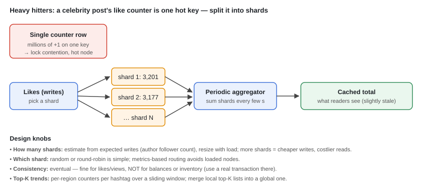

**26. Ad Click Aggregation** <a id="sd-26"></a>
- 流式聚合（Flink）按 ad_id + 分钟窗口；watermark 处理迟到事件（late events）。
- 精确性：至少一次 + 幂等写（窗口结果 upsert）或端到端 exactly-once（checkpoint + 事务（transactional）sink）。
- 对账（reconciliation）：流式结果与批处理结果定期比对（Lambda / Kappa 讨论）。
- 热点广告：key 加盐预聚合再合并。

> 下面 27–29 是 2026-10-26 消化 Grokking *Modern System Design Interview* 时补的缺口题（原题库没有）。

**27. Proximity / Ride-hailing（Yelp “附近的店”、Uber 派单）** <a id="sd-27"></a>
- **空间索引（spatial index）三选一**：固定网格（简单，但市中心一格几千个、郊区一格 0 个）· **四叉树（quadtree）**（一格超过 N 个就一分为四，密集区格子小；5 亿地点约 12 GB，单机内存放得下）· **geohash**（经纬度编码成字符串，前缀相同≈相邻，用普通 DB/KV 建索引，查本格 + 8 个邻格）。面试默认说 geohash 或四叉树，并说出边界格要查邻格。
- **读多 vs 写多决定更新方式**：Yelp 店铺几乎不动 → 索引和评分**每天低峰重建一次**；Uber 司机每 ~4 秒上报 → **最新位置写进哈希表（Redis），空间索引每 10–15 秒刷新一次**，匹配时先用索引找候选、再用哈希表里的精确位置。
- **分区按 ID 不按地区**：按地区分区遇到旅游旺季/高峰会把一台机器打爆。
- **ETA**：路网是图，直接 Dijkstra 太慢 → 图分区 + 分区内预计算捷径（contraction hierarchies），实时路况当边权，再用 ML 模型修正残差。
- **存储**：进行中的行程放事务（transaction）型 DB（频繁、需要一致的更新）；结束的行程和位置历史放宽列存储。
- *"Locations change every few seconds, so I keep the latest position in a hash and refresh the spatial index on a slower cadence — the index only needs to find candidates, not be exact."*

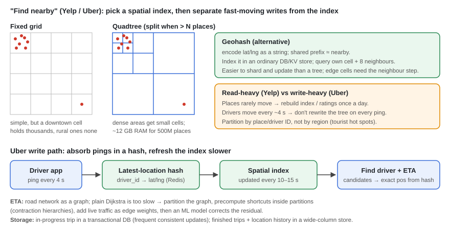

**28. Video Streaming（YouTube）** <a id="sd-28"></a>
- **写路径是慢的异步流水线**：可续传分片上传 → 临时上传存储 → 队列 → 转码（transcoding） worker（切片并行编码成多种分辨率）→ blob 存储 → 元数据置 READY；同时生成缩略图、指纹去重、内容审核。
- **读路径几乎全是 CDN**：热门在边缘 CDN，中等热度在区域/ISP 缓存，长尾回源；播放器做**自适应码率（adaptive bitrate）**（按实测带宽选下一段的清晰度）。
- **成本中心是出网（egress）带宽，不是 QPS** → 边缘命中率（hit ratio）是关键指标（metrics）；低流量地区用公共 CDN，量大了自建更划算。
- 一致性：播放数/点赞/feed 最终一致，账户数据强一致（分开存）；MySQL 分片后用路由层（Vitess 类）对应用透明，而不是每个服务自己写分片逻辑。

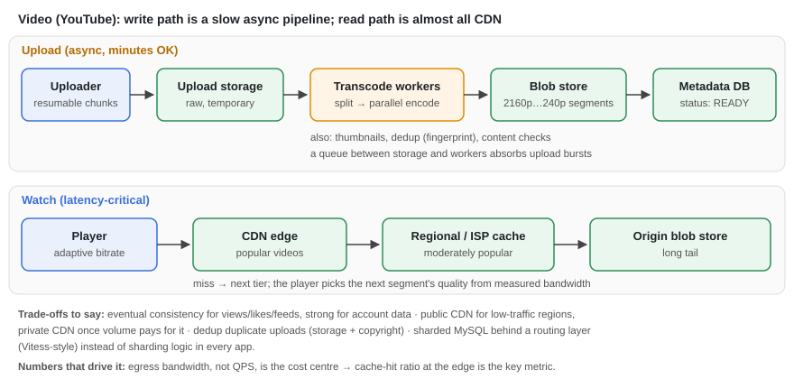

**29. Collaborative Editing（Google Docs）** <a id="sd-29"></a>
- **难点是位置会漂移**：两人并发插入/删除，按不同顺序应用得到不同文档；操作既不满足交换律也不幂等。**锁是错的答案**（同一段落的人全被挡住）。
- **OT**：中心服务器给操作排序，并把后到的操作按先到的“变换”（如 delete(2) 在 insert(1) 之后变成 delete(3)）；基于下标、操作小，Google Docs 用它；缺点是要中心排序、变换函数极难写对。
- **CRDT**：每个字符一个全局唯一 ID + 位于邻居之间的位置（如 1.5），操作按 ID 而不是下标 → 可交换、幂等，任意顺序都收敛，支持离线/点对点；代价是每字符元数据和墓碑（tombstones），需要压缩。
- 周边：每个编辑者一条 WebSocket；操作队列把细碎编辑批量落库；历史存 append-only/时序存储（版本恢复 = 重放/diff）；光标和在线状态走 pub-sub；评论另存。

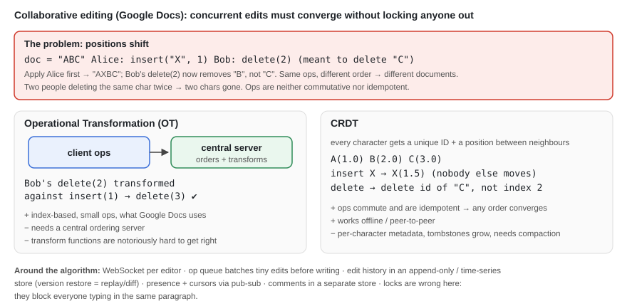

### 3.10 领域题关键点 <a id="s3-10"></a> [↑ 目录](#toc)

**19. Fraud / Risk Rules Engine** <a id="sd-19"></a>
- 同步决策路径（<100 ms）：特征服务（实时 + 离线特征）→ 规则 + 模型打分 → allow / challenge / review / block。
- 规则配置化、版本化、可 shadow 运行（只记录不生效）后再启用；冠军/挑战者实验。
- 降级（graceful degradation）：模型服务挂了 → 回退规则或默认策略，**必须事先定义 fail-open/fail-closed**。
- 人审容量是约束 → 阈值按容量调；反馈闭环（feedback loop；人审结果回流训练）。

**20. Audit Log Service** <a id="sd-20"></a>
- Append-only、不可篡改（哈希链 / WORM 存储）；写路径异步但**不可丢**（outbox）。
- 结构：who / what / when / on-what / why（政策版本、依据证据）/ 结果。
- 查询：按实体与时间索引；冷热分层；保留期（retention period）按法规（金融合规通常要求长期留存）。
- PII：审计日志（audit log）本身要脱敏/加密、访问也要审计。

**21. Multi-tenant Compliance-as-a-Service** <a id="sd-21"></a>
- 租户隔离：逻辑隔离（tenant_id 列 + 行级安全）vs 物理隔离（大租户独立分片（sharding））；noisy neighbor 配额（quota）。
- 每租户配置政策（复用 config 平台）；异步契约（提交 → 回调/事件）。
- 账户聚合：一个法律实体在多个业务线的身份复用 vs 隔离。

**22. Idempotency-Key Service / Unique ID Generator** <a id="sd-22"></a>
- **ID 生成器的完整答法（含两张流程图、原帖纠错、追问英文回答）见 [§3.11](#s3-11)**；下面是一句话版。
- ID：Snowflake（时间戳 + 机器号 + 序号，时钟回拨（clock moving backwards）处理）、号段模式（segment allocation）、UUIDv7（时间可排序）。
- **课程补充：方案对比一句话版**——UUID（无协调、128 位、不可排序）· DB 自增（单点（single point of failure）、慢）· 号段/范围分配（唯一、快、无因果）· Snowflake（1 符号位 + 41 位毫秒 ≈ 69 年 + 10 位 worker = 1024 台 + 12 位序号 = 每毫秒 4096 个；可排序，但依赖物理时钟，NTP 回拨会破坏顺序）· 向量时钟（真因果，但长度随节点数增长）· TrueTime（返回时间区间，区间不重叠才能定序，要 GPS/原子钟）。ID 里加随机位，防外部推算你的订单量。
- 幂等键（idempotency key）：`(client_id, key) → (request_hash, status, response)`，TTL 24h+；处理中状态防并发（插入即占位）。
- 同键不同请求体 → 拒绝；结果未知时让客户端轮询而非重放。

**23. Periodic Re-verification Scheduler（周期复审）** <a id="sd-23"></a>
- 到期日计算与存储（按 due_date 的二级索引（secondary index）/分桶表），每日扫描生成任务。
- **洪峰控制**：首次上线时大量存量用户同时到期 → 分批 cohort、到期日打散、按 vendor 容量节流。
- 任务与后果分离：复审任务 AWAITING_DATA 不等于立即限制，后果有独立 deadline。
- home KYC 与复审是不同任务，可同时 PASSED / AWAITING_DATA / payout ALLOWED。

**24. Large-scale ETL / Data Pipeline（Walmart 桥接）** <a id="sd-24"></a>
- 编排（Airflow DAG）与数据传输（消息队列（message queue）/对象存储（object storage））分离；任务幂等（按分区覆写）。
- 数据质量（data quality）：schema 校验、行数/分布检查、失败隔离；回填（backfill）策略。
- 迟到数据（late-arriving data）、依赖上游（upstream）SLA；监控数据新鲜度（freshness）。
- **只讲简历能支撑的事实**（Airflow + RabbitMQ、库存补货、迁移上云）；没材料的细节用 “If I designed it today…” 引出。

**25. Inventory Management / Reservation** <a id="sd-25"></a>
- 库存扣减并发：条件更新（`qty >= n`）/ 预留表 + TTL / 分片库存（热门 SKU 拆子库存）。
- 多仓与补货（replenishment）：预测 → 补货单，事件驱动更新可售量。
- 一致性：订单与库存的 saga；超卖兜底（取消 + 补偿（compensation））。

### 3.11 ★ Distributed Unique ID Generator（分布式唯一 ID 生成器） <a id="s3-11"></a> [↑ 目录](#toc)

> 来源：小红书「艾坤日记」《场景题8：如何设计一个分布式唯一ID生成器》（2026-11-01，13 页图文）+ 作者在评论区的更正 + Grokking *Modern System Design Interview* 的 Sequencer 一章（§3.10 #22 已收）。行为细节按美团 Leaf 开源实现核对过；原帖有两处错误，见本节「原帖纠错」，**面试照本节说，不要照原帖说**。

**这题考什么（一句话）**：分库分表（sharding：一张大表拆到很多个数据库里）之后，单个数据库的自增主键（AUTO_INCREMENT：数据库自动给新行编 1、2、3…）就不能用了，因为每个库都会从 1 开始编、彼此重复。所以要一个独立的服务，给全公司每一笔订单、支付流水发一个**全局唯一、大致按时间递增、64 位整数**的 ID。

**需求（先问清楚再画图）**

| 要问的 | 一般答案 | 它决定什么 |
|---|---|---|
| 要多快、多少量？ | 每秒几十万个（hundreds of thousands per second），单次取号微秒级（microseconds） | 能不能每次都去问数据库——不能 |
| 要不要递增（monotonic：后发的比先发的大）？ | 大致递增就够（roughly time-ordered）；严格连续不需要 | Snowflake 只保证大致递增，号段模式保证单调 |
| 能不能有空洞（gaps：中间有号没用上）？ | 可以 | 号段模式宕机会丢一段号，这是可接受的代价 |
| 要多可用？ | 99.999%：发号停了，下单就停了 | 发号器不能是单点（single point of failure） |
| 对外会不会暴露？ | 订单号会给用户看 | 要不要做混淆（obfuscation：让外人看不出递增规律），见下文 |

> *"Before picking an approach I'd confirm three things: the peak rate, whether IDs need to be strictly monotonic or just roughly time-ordered, and whether they're exposed to customers — because that last one changes what we show externally."*

**常见方案为什么不够（选型对比）**

| 方案 | 唯一 | 有序 | 长度 | 主要问题 |
|---|---|---|---|---|
| UUIDv4（随机 UUID，universally unique identifier） | ✅ 概率上唯一 | ❌ 完全随机 | 128 位（36 个字符） | 做 MySQL 主键时插入位置随机 → B+ 树页分裂（page split：一页写满被硬拆成两页），写性能明显下降 |
| UUIDv7 / ULID（按时间排序的 UUID） | ✅ | ✅ 毫秒级大致有序 | 128 位 | 没有协调、实现简单；缺点是比 64 位长一倍，索引更大。**原帖没提，评论区补了，面试可以主动说** |
| 单库自增 / Redis INCR（原子自增） | ✅ | ✅ 严格递增 | 64 位 | 一个中心节点扛所有请求，会被打满，而且是单点 |
| **号段模式（segment mode，美团 Leaf-segment）** | ✅ | ✅ 单调递增 | 64 位 | 依赖数据库（但只是偶尔取一段）；宕机丢号段 |
| **Snowflake（雪花算法）** | ✅ | ✅ 大致按时间 | 64 位 | 依赖机器时钟：时钟往回走（clock rollback）会发重复 ID |

> *"UUIDv4 is unique but random, so as a clustered primary key every insert lands in the middle of the B+ tree and causes page splits. If I want something UUID-like but sequential, UUIDv7 or ULID; if I need a compact 64-bit number at very high rates, it's either a segment allocator or Snowflake."*

**为什么随机主键慢（被追问时的完整解释）**：MySQL 的 InnoDB 存储引擎（InnoDB storage engine）里，主键就是聚簇索引（clustered index：数据行在磁盘上就按主键顺序存放）。
- 递增主键：每条新行都追加在最后一页的末尾（append-only），写满就开新页，页几乎是满的，磁盘是顺序写（sequential I/O）。
- 随机主键：新行要插进中间某个已经写满的页 → 这一页被拆成两半（页分裂），每页只剩一半有用 → 页数翻倍、随机读写（random I/O）变多、内存缓冲池（buffer pool：数据库放在内存里的页）里的热页被挤出去。
- 原帖说“数百倍随机 I/O”——没给来源，**面试别报这个数**，说“明显变慢、写放大（write amplification：实际写盘量远大于数据本身）”即可。

#### 方案 A：Snowflake（雪花算法）——本地算，不走网络 <a id="h6"></a> [↑ 目录](#toc)

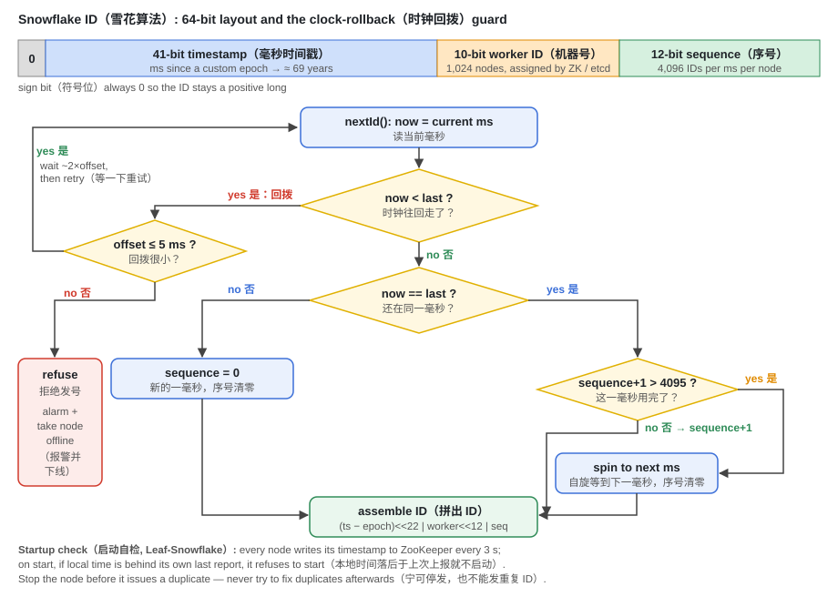

- **64 位怎么拆**：1 位符号位（sign bit，恒为 0，保证是正数）+ 41 位毫秒时间戳（timestamp，从自定义起点 epoch 算，约 69 年）+ 10 位机器号（worker ID，最多 1024 台）+ 12 位序号（sequence，同一毫秒内每台机器最多 4096 个）。
- **机器号怎么分**：服务启动时向协调服务（coordination service：ZooKeeper 或 etcd，专门存少量共享配置、做选主的集群）注册，拿到一个不重复的机器号；Leaf 会把它缓存到本地文件，协调服务挂了也能用旧号重启（weak dependency：弱依赖）。
- **最大风险——时钟回拨（clock moving backwards）**：服务器用 NTP（Network Time Protocol，网络时间协议：定时和标准时间对表）校时，或遇到闰秒（leap second），系统时间可能突然往回跳几毫秒甚至几秒。时间戳一旦回到用过的值，就会发出和以前一模一样的 ID → 数据库主键冲突。
- **三层防护**（从轻到重）：
  1. **小回拨（≤ 5 ms）就等**：等大约两倍回拨时长再重读时间，追上了就继续发号；还没追上就报错。
  2. **大回拨就拒绝发号 + 报警 + 下线**：宁可这台机器暂时不发号（其他机器接流量），也不能发重复 ID。
  3. **启动自检（Leaf-Snowflake 的做法）**：每台机器每 3 秒把自己的当前时间写到 ZooKeeper；重启时如果本地时间比自己上次写的还早，就拒绝启动。
- 原帖还提了“机器号借道（WorkerId shifting）”：把 10 位机器号拆成 5 位真实机器号 + 1 位备用位 + 4 位扩展位，回拨时翻转备用位继续发号。**这是作者自己的设计，不是 Leaf 的**；代价是真实机器只剩 32 台，而且备用位只能扛一次回拨。面试提的话要说清这两个代价。
- 核心代码（面试被要求写时，Java）：

```java
public synchronized long nextId()
{
    long now = System.currentTimeMillis();
    if (now < lastTimestamp)
    {
        long offset = lastTimestamp - now;
        if (offset > MAX_BACKWARD_MS)
        {
            throw new IllegalStateException("clock moved backwards by " + offset + " ms");
        }
        waitMillis(offset * 2);
        now = System.currentTimeMillis();
        if (now < lastTimestamp)
        {
            throw new IllegalStateException("clock still behind after waiting");
        }
    }
    if (now == lastTimestamp)
    {
        sequence = (sequence + 1) & SEQUENCE_MASK;
        if (sequence == 0)
        {
            now = waitUntilNextMillis(lastTimestamp);
        }
    }
    else
    {
        sequence = 0L;
    }
    lastTimestamp = now;
    return ((now - EPOCH) << 22) | (workerId << 12) | sequence;
}
```

> *"Snowflake packs a millisecond timestamp, a worker ID and a per-millisecond sequence into 64 bits, so IDs are generated locally with no network call and are roughly time-ordered. The real risk is the clock moving backwards: for a few milliseconds I wait it out; beyond that the node refuses to issue IDs and alerts, and on startup it refuses to boot if its clock is behind the last time it reported to ZooKeeper. I'd rather lose a node than issue a duplicate."*

#### 方案 B：号段模式 + 双缓冲（Leaf-segment, double buffer）——批量向数据库要号 <a id="h7"></a> [↑ 目录](#toc)

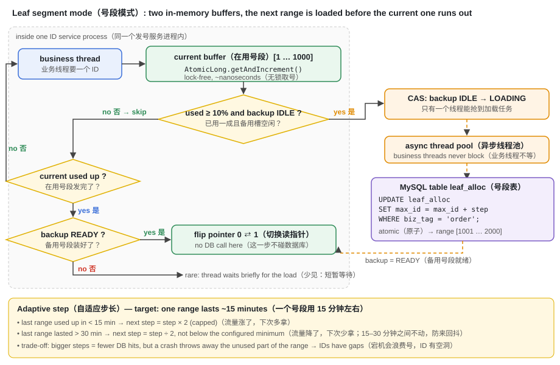

- **思路**：不是每个 ID 都问数据库，而是一次要一整段（比如 1000 个），在内存里一个个发；数据库只负责“记录发到哪了”。
- **数据库表（号段表）**：`leaf_alloc(biz_tag, max_id, step, update_time)`，每个业务（biz_tag，如 order）一行，`max_id` 是已经分出去的最大号，`step` 是一次拿多少。
- **要一段**：`UPDATE leaf_alloc SET max_id = max_id + step WHERE biz_tag = 'order'` 再读回新的 `max_id`——这条更新是原子的（atomic：多台发号服务同时执行也不会拿到重叠的段）。
- **双缓冲（double buffer）**：内存里放两个号段槽位。
  1. 业务线程从“在用号段”里用 `AtomicLong.getAndIncrement()`（原子计数器：多线程同时取也不会重复）取号，纳秒级、不加锁。
  2. **在用号段已经用掉 10%** 且备用槽空闲时，用 CAS（compare-and-swap，比较并交换：只有一个线程能把状态从 IDLE 改成 LOADING）抢到加载任务，交给异步（async）线程池去数据库要下一段。业务线程不等。
  3. 在用号段发完时，备用号段通常早就 READY 了 → 直接切换读指针，请求路径上完全不碰数据库。
  4. 极少数情况（数据库很慢、流量暴涨）备用段还没好，线程会短暂等待。
- **自适应步长（adaptive step）**：目标是一个号段大约用 15 分钟。上一段不到 15 分钟就用完 → 下次步长 ×2（有上限）；超过 30 分钟才用完 → 步长 ÷2（不低于配置的最小值）；15–30 分钟之间不变，防止来回抖动。流量涨 100 倍时，步长翻倍 7 次左右就跟上了（1000 → 128,000）。
- **代价**：服务重启时，内存里没发完的号段直接丢弃 → ID 有空洞（gaps）；步长越大，丢得越多。所以“ID 必须连续”的需求（比如发票号）不能用这个方案。

> *"Instead of asking the database for every ID, each node leases a range — say a thousand — with one atomic UPDATE and hands IDs out from memory. With two buffers, once the current range is ten percent used, a background thread fetches the next one, so the request path never waits on the database. The step adapts so a range lasts about fifteen minutes; the cost is that a crash wastes the rest of its range, so IDs have gaps."*

#### 怎么选 <a id="h8"></a> [↑ 目录](#toc)

| 场景 | 选 | 一句话理由 |
|---|---|---|
| 量极大、不想依赖数据库、能接受“大致递增” | Snowflake | 纯本地计算，没有网络调用 |
| 要严格单调、ID 想短、已有可靠的 MySQL | 号段模式 | 数据库只被偶尔访问；没有时钟问题 |
| 不想自己维护服务、能接受 128 位 | UUIDv7 / ULID | 零协调，天然按时间排序 |
| ID 要对外给用户看 | 任一方案 + 对外混淆（见下） | 内部存真实 ID，对外显示混淆后的号 |

> *"Given these requirements I'd pick a segment allocator: we already run a reliable MySQL, we want short monotonic IDs, and it has no clock dependency. If the database were the thing we wanted to avoid, I'd use Snowflake with a clock-rollback guard."*

#### 对外单号：别让竞争对手数出你的订单量 <a id="h9"></a> [↑ 目录](#toc)

- **问题**：递增 ID 直接显示给用户，别人下两单、看两个单号一相减，就知道你这段时间卖了多少单（这就是二战时用坦克序列号估产量的“德国坦克问题”）。
- **原帖的公式有漏洞**：`Cipher_ID = (Real_ID × Large_Prime + Offset) % Modulo` 是仿射变换（affine transform：乘一个数再加一个数）。相邻两个真实 ID 变换后永远相差同一个常数，**拿到两个单号就能精确算出中间隔了多少单**。验证：Large_Prime=1,000,003、Modulo=10⁹ 时，真实 ID 1000 和 1500 的密文一减、再乘模逆元（modular inverse），正好得到 500。
- **正确做法**：
  - 用**带密钥的（keyed）** Feistel 网络（Feistel network：一种把数字可逆打乱的结构，没有密钥就还原不出来）或保格式加密（format-preserving encryption，如 NIST FF1：加密后还是同样位数的数字）。密钥放在密钥管理服务（KMS，key management service）里，只有发号服务能用。
  - 或者对外单号单独生成（业务前缀 + 日期 + 分库路由位 + 随机串），和内部主键建一张映射表。
- 原帖的复合格式（业务标识 2 位 + 日期 6 位 + 分库路由位 2 位 + 混淆串 8 位）**格式本身可以用**，前提是那 8 位用上面带密钥的方式生成。

> *"Internally I keep the sequential 64-bit ID as the primary key. Externally I never show it raw — a sequential number leaks order volume to anyone who places two orders. I'd map it through a keyed permutation such as a Feistel network or format-preserving encryption, with the key in KMS; a simple multiply-and-add isn't enough, because the difference between two outputs still reveals the count."*

#### 追问 & 英文回答 <a id="h10"></a> [↑ 目录](#toc)

| 追问 | 中文要点 | 英文回答（可直接说） |
|---|---|---|
| 为什么不用 UUID 做主键？ | 随机 → 聚簇索引页分裂、随机 I/O；128 位让索引更大 | *"Random UUIDs land anywhere in the clustered index, causing page splits and random I/O. If I want UUIDs, I'd use UUIDv7 so inserts stay append-only."* |
| 时钟回拨怎么办？ | 小回拨等；大回拨拒发 + 报警 + 下线；启动时和 ZooKeeper 里的上次时间比 | *"Wait out a few milliseconds; beyond that, refuse to issue IDs, alert, and fail the node's health check. On startup, compare against the last timestamp it reported to ZooKeeper."* |
| 一毫秒内 4096 个用完了？ | 自旋等到下一毫秒；量再大就加机器或者少给机器号多给序号位 | *"It spins to the next millisecond. If that's a real bottleneck, I'd trade worker bits for sequence bits or add nodes."* |
| 大促流量暴涨 100 倍，号段几毫秒就用完？ | 自适应步长：用得快就 ×2；双缓冲提前加载 | *"The step adapts: if a range lasts under fifteen minutes the next one doubles, and the double buffer preloads at ten percent, so the database sees a request every few minutes, not every few milliseconds."* |
| 号段模式数据库挂了？ | 内存里还有当前段 + 备用段可用；步长大的话能撑十几分钟；数据库做主从切换 | *"Both buffers are already in memory, so we keep issuing for minutes while the database fails over. That's another reason to size the range by time, not by count."* |
| 发号服务本身怎么高可用？ | 多实例无状态部署；号段模式各实例拿不同的段，Snowflake 各实例不同机器号 | *"Run several instances behind a load balancer; segments never overlap because of the atomic UPDATE, and Snowflake nodes never share a worker ID."* |
| 怎么防别人推算订单量？ | 对外号用带密钥的可逆打乱；乘加公式不够 | *"A keyed Feistel permutation or FPE for anything customer-facing; an affine formula still leaks the count from two samples."* |

#### 原帖纠错（照原帖说会被问倒的地方） <a id="h11"></a> [↑ 目录](#toc)

| 原帖 | 问题 | 正确说法 |
|---|---|---|
| 第 8 页：“消耗超过 90%（只剩 10%）才异步加载” | 和第 4 页“消耗达 10% 就加载”矛盾；作者已在评论区更正 | **用掉 10% 就开始加载下一段**（Leaf 实现就是这样），用 CAS 保证只触发一次 |
| 第 12 页：乘加公式让“黑客完全无法看出递增规律” | 仿射变换保留差值，两个单号就能算出间隔订单数 | 用带密钥的 Feistel 网络或 FPE |
| 第 5 页代码：时钟一回拨就抛异常 | 和第 6 页“小回拨等待”的说法不一致 | 小回拨等待、大回拨才拒发（见上面代码） |
| 第 11 页：“超过 15 分钟就把步长减半” | Leaf 实际是超过 30 分钟才减半 | 15–30 分钟之间不变，防来回抖 |
| “数百倍随机 I/O”“性能断崖” | 无来源 | 说“明显变慢、写放大”，不报具体倍数 |

<small>

**📖 名词解释**
- **分库分表（sharding）**：一张表太大，按某个键拆到多个数据库里存。拆了之后各库的自增 ID 会互相重复。
- **自增主键（AUTO_INCREMENT）**：数据库在插入新行时自动编号 1、2、3…，只在单个库内唯一。
- **单调递增（monotonically increasing）**：后发的 ID 一定比先发的大。“大致按时间递增（roughly time-ordered）”则允许不同机器之间有少量乱序。
- **聚簇索引（clustered index）**：InnoDB 把整行数据按主键顺序放在 B+ 树的叶子页里；主键的顺序就是数据在磁盘上的顺序。
- **页分裂（page split）**：要往一个已经满了的页中间插数据，只能把这页拆成两页各放一半，既慢又浪费空间。
- **写放大（write amplification）**：为了写一点数据，实际写到磁盘的数据多得多（比如为插一行而重写两整页）。
- **UUIDv7 / ULID**：前 48 位是毫秒时间、后面是随机数的 128 位 ID，生成时不用协调，而且按时间排序，插入数据库时是追加写。
- **时钟回拨（clock moving backwards）**：服务器时间被校时（NTP）或闰秒调整后突然往回跳。
- **NTP（Network Time Protocol，网络时间协议）**：服务器定期和标准时间服务器对表的协议。
- **ZooKeeper / etcd（协调服务）**：存少量共享配置、分配编号、做选主的小集群，这里用来分机器号、记录各节点上报的时间。
- **CAS（compare-and-swap，比较并交换）**：“如果现在的值还是 A，就改成 B”，一步完成；多个线程同时抢时只有一个成功。
- **AtomicLong**：Java 的原子长整型计数器，多线程同时加一也不会重复或丢失。
- **步长（step）**：号段模式一次从数据库拿多少个号。
- **空洞（gaps）**：有些号被分出去但没用上（例如服务重启丢掉了内存里的号段）。
- **德国坦克问题（German tank problem）**：根据观察到的几个序列号估算总数量的经典统计问题——这就是递增单号会泄露业务量的原因。
- **仿射变换（affine transform）**：`a × x + b` 这类“乘一个数再加一个数”的变换；输入相差多少，输出就按固定比例相差多少，所以藏不住规律。
- **Feistel 网络（Feistel network）**：用密钥把数字分成两半反复混合的可逆结构，没有密钥无法还原，也看不出相邻关系。
- **保格式加密（FPE，format-preserving encryption）**：加密后结果和原来格式一样（比如还是 18 位数字），标准算法有 NIST FF1 / FF3-1。
- **KMS（key management service，密钥管理服务）**：集中保管加密密钥的服务，应用只能调用它、拿不到明文密钥。

</small>

### 3.12 ★ Top-K / Trending（实时热门榜：最近一小时最热的 K 个） <a id="s3-12"></a> [↑ 目录](#toc)

> **题目（EN）**: *"Design a service that shows the top K most-viewed items (videos, products, hashtags) over the last hour, updated every minute, at about one million view events per second."*
>
> ```text
> Input : a stream of events  {itemId: "v42", userId: "u7", ts: 1793944130123}
> Query : GET /trending?window=1h&k=10
> Output: [{"itemId":"v42","count":918233}, {"itemId":"v17","count":702114}, ...]   // refreshed every ~60 s
> ```
>
> 本节把 §3.9 #18 的一句话版展开。热点计数（大 V 帖子的点赞数）仍用 #18 里的分片计数器（sharded counter），本节讲的是“从海量事件里选出前 K 名”。

**先问清的需求（scoping）**

| 问什么 | 为什么影响设计 | 默认假设 |
|---|---|---|
| 时间范围：全时段 vs 最近 1 小时 / 1 天 | 全时段只加不减，一个计数器就够；“最近 1 小时”要让旧数据**过期**，需要窗口（window） | 最近 1 小时，每分钟刷新 |
| 新鲜度（freshness）：秒级还是分钟级 | 决定窗口粒度和要等迟到数据多久 | 分钟级 |
| 精确（exact）还是近似（approximate） | 决定能不能用 Count-Min 这类概率结构 | 热门榜接受近似；计费类必须精确 |
| 数“次数”还是数“人数” | 同一个人刷 1000 次算不算 1000？防刷要按去重用户数（distinct users） | 数次数，单用户每窗口限计 1 次（可选） |
| 维度（dimension）：全站 / 按国家 / 按类目 | 维度一多，榜单数量相乘 | 全站 + 热门国家 |
| 规模：事件/秒、每小时不同 item 数、K 多大 | 决定能不能精确计数 | 1M 事件/秒；1 亿不同 item/小时；K ≤ 100 |

> EN: *"Before I draw anything: is it all-time or a sliding window, how fresh does it need to be, and can it be approximate? For a trending list I'd assume the last hour, refreshed every minute, approximate is fine — billing would be a different answer."*

**估算（back-of-the-envelope）——它决定要不要近似**
- 每小时事件数：1M/s × 3600 ≈ **36 亿**。
- **精确计数**：1 亿个 item × 每个约 60 B（id + 计数 + 哈希表开销）≈ **6 GB**；按 itemId 分 32 个分区，每个约 200 MB。**一个固定窗口（fixed window）精确计数通常放得下**，所以默认先说精确。
- 真正撑爆内存的是**滑动窗口**：“最近 60 分钟、每分钟滑动”要保留 60 个分钟桶，内存 ×60；再乘上国家 × 类目的维度，就该上近似结构了。
- Count-Min 的大小这样算（见下方公式）：每个分区每小时约 N = 36 亿 / 32 ≈ 1.1 亿事件；第 K 名大约 10 万次，希望误差 ≤ 1%（1,000 次），所以 ε ≈ 1,000 / 1.1 亿 ≈ 9×10⁻⁶ → w = e/ε ≈ 30 万列，d = ln(1/0.01) ≈ 5 行 → 150 万个 4 字节计数器 ≈ **6 MB/分区**。
> EN: *"Exact counts for a hundred million items are about six gigabytes, which fits once partitioned, so I'd start exact. Sliding windows and per-country boards multiply that, and that's where Count-Min earns its place — about six megabytes per partition for a one-percent error on the K-th item."*

**演进（evolution）：别一上来就画 Flink**
- **v1（几万事件/秒以内）**：每个事件 `ZINCRBY trending <itemId> 1`，读 `ZREVRANGE 0 K-1`。简单，但 Redis 单线程、单 key 是热点，滑动窗口要自己按分钟分 key 再 `ZUNIONSTORE`。
- **v2**：应用服务器先在内存里按秒预聚合（pre-aggregate），每秒批量写一次 `ZINCRBY`，写量降两三个数量级。
- **v3（百万事件/秒）**：下面的流式管道（streaming pipeline）。
> EN: *"At a few thousand events per second I'd just ZINCRBY a sorted set. I move to a streaming pipeline only when one Redis key becomes the bottleneck."*

#### 主路径：按 itemId 分区 → 窗口计数 → 本地 top-k → 合并 → Redis <a id="h12"></a> [↑ 目录](#toc)

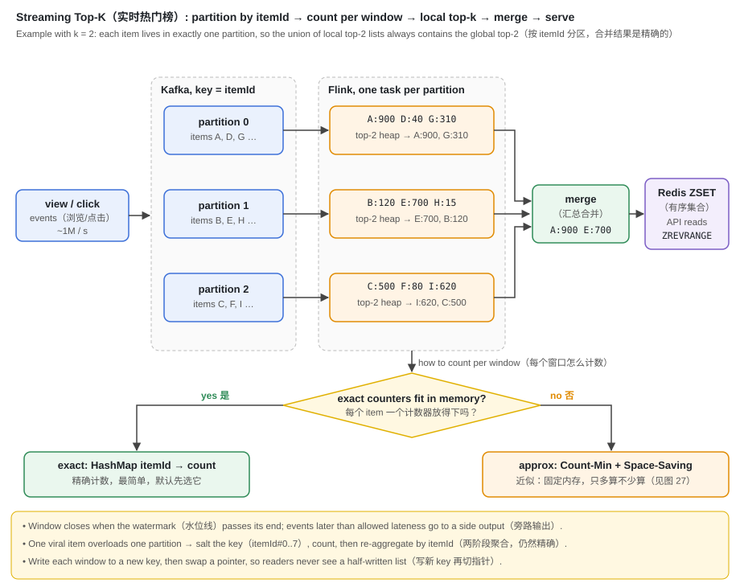

1. **Kafka 按 itemId 分区（partition key = itemId）**：同一个 item 的所有事件进同一个分区，所以**每个 item 只在一个地方被计数**，每个分区里的计数都是完整的。这是整个设计能精确合并的前提。
2. **Flink 窗口计数（windowed count）**：每个分区一个任务，在窗口内维护 `itemId → count`。窗口按事件时间（event time）划分，不按机器收到的时间。
3. **本地 top-k 堆（local top-k heap）**：窗口结束时，每个任务用**大小为 k 的小顶堆（min-heap）**扫一遍计数表：新 item 比堆顶大就替换堆顶，O(n log k)。（LeetCode 347 同一个套路。）
4. **合并（merge）**：一个单并行度的合并任务收齐所有分区的本地 top-k，再取一次 top-k。**因为 item 不跨分区，全局前 K 一定出现在某个分区的本地前 K 里，所以合并是精确的。** 如果按随机或按 userId 分区，同一个 item 的计数被拆散到多个分区，本地前 K 的并集就会漏掉“每个分区都不高、加起来很高”的 item。
5. **写 Redis 有序集合（sorted set, ZSET）**：每个窗口写一个新 key（如 `trending:global:202611051310`），写完再把指针 key 切过去；API 只读，`ZREVRANGE key 0 9`。读路径完全不碰流处理。

> EN: *"I partition events by itemId so each item is counted in exactly one place. Each Flink task keeps windowed counts and a size-k min-heap, and a single merge task combines the local top-k lists. That merge is exact because no item is split across partitions. The result is written to a new Redis key per window and a pointer is swapped, so the API only ever reads a complete list."*

#### 精确 vs 近似：Count-Min Sketch + Space-Saving <a id="h13"></a> [↑ 目录](#toc)

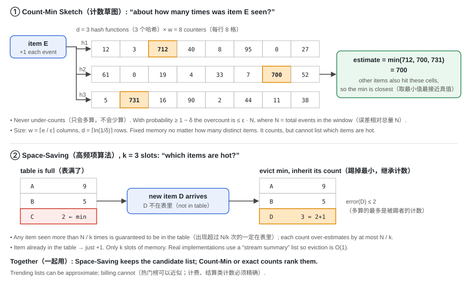

- **Count-Min Sketch（计数草图）**：d 行 × w 列的计数器，每行一个哈希函数。来一个事件，每行把对应格子 +1；查询时取 d 个格子里的**最小值**。
  - 只会多算、不会少算（别的 item 撞到同一格只会让数变大）。
  - 误差保证：以至少 1 − δ 的概率，多算的量 ≤ ε × N（N = 窗口内总事件数）。大小：w = ⌈e/ε⌉，d = ⌈ln(1/δ)⌉。**误差是相对总量 N 的**，所以只对高频 item 准，长尾 item 的估计没意义——这正好符合 top-K 的需要。
  - 它能回答“E 大概出现了几次”，但**列不出谁最多**，所以要配一个候选名单。
  - 同样哈希的两个草图可以**逐格相加或相减**，滑动窗口能直接用（见下一小节）。
- **Space-Saving（高频项算法, heavy hitters）**：只留 k 个槽。新 item 已在表里就 +1；不在且表满了，就**踢掉计数最小的那个，新 item 继承它的计数再 +1**。
  - 保证：出现次数超过 N/k 的 item 一定在表里；每个计数最多多算 N/k。
  - 用“stream summary”链表可以 O(1) 找到最小值；面试写 O(k) 扫描版就够。
- **一起用**：Space-Saving（或每分钟的本地 top-k）给候选名单，Count-Min 或精确计数给排序。近似时每个分区要**多留一些候选**（例如 K=10 时本地留 1,000 个），给误差留余量（headroom）。
- **什么时候必须精确**：计费、结算、广告扣费、配额。这些走精确计数 + 批处理对账（reconciliation），见 §3.9 #26。

```java
public class SpaceSaving
{
    private final int capacity;
    private final Map<String, Long> countMap = new HashMap<>();

    public SpaceSaving(int capacity)
    {
        this.capacity = capacity;
    }

    public void add(String item)
    {
        Long count = countMap.get(item);
        if (count != null)
        {
            countMap.put(item, count + 1);
            return;
        }
        if (countMap.size() < capacity)
        {
            countMap.put(item, 1L);
            return;
        }
        String minItem = null;
        long minCount = Long.MAX_VALUE;
        for (Map.Entry<String, Long> entry : countMap.entrySet())
        {
            if (entry.getValue() < minCount)
            {
                minCount = entry.getValue();
                minItem = entry.getKey();
            }
        }
        countMap.remove(minItem);
        countMap.put(item, minCount + 1);
    }

    public List<Map.Entry<String, Long>> topK(int k)
    {
        PriorityQueue<Map.Entry<String, Long>> minHeap = new PriorityQueue<>(Map.Entry.comparingByValue());
        for (Map.Entry<String, Long> entry : countMap.entrySet())
        {
            minHeap.offer(entry);
            if (minHeap.size() > k)
            {
                minHeap.poll();
            }
        }
        List<Map.Entry<String, Long>> result = new ArrayList<>(minHeap);
        result.sort(Map.Entry.<String, Long>comparingByValue().reversed());
        return result;
    }
}
```

> 走一遍（k = 3）：已有 A:9, B:5, C:2 → 来了 A：A 在表里，变 A:10 → 来了 D：不在表里且表满，最小的是 C:2，踢掉 C，写入 D:3。D 的真实次数可能只有 1，多算的最多是 2（被踢者 C 的计数）。`topK(2)` 用大小为 2 的小顶堆，返回 A:10, B:5。

> EN: *"If exact counters don't fit, Count-Min Sketch gives me a fixed-size frequency estimate that only over-counts, by at most epsilon times the window total, and Space-Saving keeps the candidate list in k slots — anything above N over k is guaranteed to be there. I keep extra candidates per partition to absorb the error."*

#### 窗口与迟到数据：滚动 / 滑动 / watermark <a id="h14"></a> [↑ 目录](#toc)

- **滚动窗口（tumbling window）**：固定长度、不重叠，例如每分钟一个（0–1 分、1–2 分…）。最便宜。
- **滑动窗口（sliding window）**：长度 1 小时、每分钟往前滑一次。实现上**不要每分钟重算一小时**，而是用 60 个一分钟的桶：
  - 精确计数：维护一份“当前一小时”的累计表，每分钟**加上最新一分钟、减去滑出去的那一分钟**，再从累计表里重选 top-k（小顶堆不能处理“减少”，所以选前 K 是每分钟重做一次）。
  - 近似计数：每分钟一个 Count-Min 草图；一小时的草图 = 累计草图 + 最新一分钟 − 最老一分钟（逐格加减）。候选名单 = 最近 60 个分钟的本地 top-k 的并集，再用一小时草图给它们排序。
- **watermark（水位线）**：Flink 对“时间戳早于 T 的事件基本都到了”的估计，通常是“见过的最大事件时间 − 允许乱序时间（例如 30 秒）”。watermark 越过窗口结束时间，窗口才出结果。
- **比 watermark 还晚的事件**：三种处理——丢掉；放进旁路输出（side output）事后修正；或者设 allowed lateness，让窗口再更新一次结果。取舍是**等得越久越准，但榜单越旧**。热门榜通常等几十秒就够。
> EN: *"I use one-minute buckets and slide by adding the newest bucket and subtracting the oldest — Count-Min sketches add and subtract cell by cell, so that works for the approximate path too. The watermark trails the max event time by about thirty seconds; anything later goes to a side output instead of holding the board back."*

#### 热点、重算与上线 <a id="h15"></a> [↑ 目录](#toc)

- **热点 item（hot key / skew）**：按 itemId 分区意味着一个爆款的全部流量压在一个分区。**两阶段聚合（two-phase aggregation）**：第一阶段 key 加随机后缀 `itemId#0..7`，分散到 8 个任务各自计数；第二阶段按 itemId 再聚合一次，然后才进入本地 top-k。因为第二阶段又回到“一个 item 一个地方”，合并仍然精确。
- **防刷（bots）**：热门榜更合理的是数“多少不同用户看过”。用 HyperLogLog 按 item 估去重用户数，或者每个 (user, item, window) 只计一次（用一个短 TTL 的去重集合）。
- **多维度榜单**：key 变成 `(country, category, itemId)`，每个组合一份 top-k。只给流量大的维度做实时榜；长尾维度从 OLAP 存储（Druid / Pinot / ClickHouse）按需查询。
- **重算（recompute）**：计数逻辑有 bug、或要补历史时：
  - **Lambda 架构**：流式路径（快、可能近似）+ 批处理路径（每晚跑 Spark 全量、精确），批结果覆盖流结果。代价是同一套逻辑写两遍，两边可能算得不一样。
  - **Kappa 架构**：只有流式路径；重算就是把新版本作业从 Kafka 的旧 offset 重放一遍，写到新的输出 key，验证后切指针。前提是 Kafka 保留期够长（见 [§2.18](#s2-18) 第 2 题：日志可回放）。热门榜默认选 Kappa。
- **故障恢复**：Flink 定期 checkpoint 计数状态和 Kafka offset，挂了从 checkpoint 恢复。结果按窗口 key 覆盖写（upsert），重复执行也不会把数算两遍——这是幂等（idempotent）输出，不需要端到端事务。
> EN: *"A viral item would pin one partition, so I salt the key for a first-stage count and re-aggregate by itemId before the top-k step, which keeps the merge exact. For recomputation I'd go Kappa: replay Kafka into a new output key, compare, then swap the pointer."*

#### 追问 & 英文回答 <a id="h16"></a> [↑ 目录](#toc)

| 追问 | 要点 | EN |
|---|---|---|
| 为什么按 itemId 分区，不按 userId？ | 按 itemId 每个 item 只在一个分区计数，本地前 K 合并就是精确的；按 userId 会把一个 item 拆散，合并会漏 | *"Partitioning by item keeps each item's count in one place, so merging local top-k lists is exact. By user, an item's count is split and the merge can miss it."* |
| 为什么不直接 Redis `ZINCRBY`？ | 小规模就该这么做；百万级时单 key 是热点、单线程扛不住，滑动窗口也不好做 | *"At small scale I would. At a million events a second one sorted-set key becomes a hot spot, so I pre-aggregate in the stream and write once per window."* |
| 滑动窗口怎么做？ | 一分钟桶；累计表加新减旧；top-k 每分钟重选；近似时用草图逐格加减 | *"One-minute buckets, add the newest, subtract the oldest, re-select top-k each minute."* |
| 什么时候用近似？误差多大？ | 精确计数放不下时（滑动窗口 × 维度）；Count-Min 只多算，误差 ≤ εN，按第 K 名的量级定 ε | *"Only when exact state doesn't fit. Count-Min over-counts by at most epsilon times N, so I size epsilon against the count of the K-th item."* |
| 爆款把一个分区打满？ | key 加盐两阶段聚合，第二阶段按 itemId 合并，仍然精确 | *"Salt the key for a first-stage count, then re-aggregate by itemId."* |
| 迟到事件？ | watermark = 最大事件时间 − 允许乱序；更晚的走旁路输出或 allowed lateness；等得久更准但更旧 | *"The watermark bounds how long I wait; later events go to a side output."* |
| 计数逻辑有 bug，怎么重算？ | Kappa：从 Kafka 重放到新 key，比对后切指针；Lambda 要维护两套逻辑 | *"Replay Kafka into a new key, verify, swap the pointer."* |
| 有人刷榜？ | 数去重用户（HyperLogLog）或每用户每窗口只计一次 | *"I'd rank by distinct users with HyperLogLog, not raw views."* |

<small>📖 名词解释</small>
<small>

- **Top-K**：从很多元素里选出最大的 K 个。
- **小顶堆（min-heap）**：堆顶永远是最小值的树形结构。保持大小为 k，堆里剩下的就是最大的 k 个。
- **滚动窗口（tumbling window）**：首尾相接、不重叠的固定时间段，例如每分钟一段。
- **滑动窗口（sliding window）**：固定长度、按步长往前移动的时间段，例如“最近 60 分钟、每分钟更新”。
- **事件时间（event time）**：事件真正发生的时间，不是服务器收到它的时间。
- **watermark（水位线）**：流处理系统认为“这个时间之前的事件基本都到齐了”的时间点。
- **旁路输出（side output）**：把迟到的数据单独输出，不影响主结果，事后再修正。
- **Count-Min Sketch（计数草图）**：用固定大小的计数器表估计每个元素出现次数，只会多算不会少算。
- **Space-Saving（高频项算法）**：只用 k 个槽找出最频繁的元素，满了就踢掉计数最小的。
- **heavy hitters（高频项）**：出现次数特别多的那几个元素。
- **两阶段聚合（two-phase aggregation）**：先把热点 key 打散分别计数，再按原 key 合并。
- **HyperLogLog**：用很小的内存估算“有多少个不同的元素”（去重计数）。
- **Lambda / Kappa 架构**：Lambda 是流式 + 批处理两条路径；Kappa 只有流式，靠重放日志重算。
- **checkpoint（检查点）**：流处理定期保存的状态快照，挂了可以从这里恢复。
- **OLAP 存储**：为大量聚合查询优化的分析型数据库，例如 Druid、Pinot、ClickHouse。
</small>

---

## 4. 把我做过的系统当设计题来讲 <a id="s4"></a> [↑ 目录](#toc)

区分“讲一个自己设计的项目”和“从零 Design X”：前者讲你当时的约束、你的决定、否决过的方案和代价；后者按本书通用框架推导，不把熟悉的既有平台机制都算作自己的设计。

- 15 分钟结构：业务问题与约束（2′）→ 架构与数据流（4′）→ 你的关键决定与否决的方案（4′）→ 失败模式与恢复（3′）→ 如果重做（2′）。
- 每个决定按“约束（constraint）→ 选择 → 替代方案 → 代价”准备一句英文。
- 被追问数字时只说经过核实、可公开的口径；分清已有平台、你的改动与今天会加的加固。
- 项目版（真实例子、取舍与数字）只存在本地：project_deep_dive 第 31 篇。

## 5. 资源 <a id="s5"></a> [↑ 目录](#toc)

只列公认、真实存在的资源（不附可能失效的具体链接）。

**书**
- *Designing Data-Intensive Applications* — Martin Kleppmann（必读：复制（replication）、分区（partitioning）、事务（transactions）、流处理（stream processing）；若第 2 版已出，优先读新版）
- *System Design Interview – An Insider's Guide*, Vol. 1 & 2 — Alex Xu（Vol. 2 与 Sahn Lam 合著；题型覆盖面广，适合补经典题）
- *Understanding Distributed Systems* — Roberto Vitillo（短小、偏工程实践）
- *Database Internals* — Alex Petrov（存储引擎、共识）
- *Site Reliability Engineering* 与 *The Site Reliability Workbook* — Google（免费在线：sre.google）
- *Building Microservices*（2nd ed.）— Sam Newman

**课程/平台**
- Hello Interview（hellointerview.com）— 有 Staff 级评分维度说明和大量题解，适合练节奏
- ByteByteGo（Alex Xu 团队）
- Grokking the System Design Interview / Grokking the Advanced System Design Interview（DesignGurus）
- Educative *Grokking Modern System Design Interview*（订阅已包含；219 节）——**2026-10-26 按 05 缺口挑读了约 22 节**：估算（back-of-the-envelope estimate）两节、WhatsApp、Twitter/News feed、Ticketmaster、Google Docs、Typeahead、Uber、Yelp、YouTube、Payment、Task scheduler、Sequencer、Sharded counters、Dropbox、三次大事故（incident）。要点在 §2.14、§2.17、§3.3、§3.5、§3.8、§3.9（含新题 27–29），**不用再看**。没读的：building block 章节（DNS、LB、KV、CDN、MQ、pub-sub、blob、search、logging——§2 已覆盖）、Quora/Instagram/Web crawler/TinyURL/Google Maps（与已有题重叠）、AI 题（ChatGPT、客服 bot、code assistant——归 06，按 AI 优先级另行消化）。课里的 AI mock（Newsfeed、Payment、Uber Eats 等）可当免费 SD mock 用。
- MIT 6.824 / 6.5840 Distributed Systems（课程视频与 Raft lab，打底层基础）
- Educative *Solutions Architect Interview Prep*（订阅已包含；31 节文字课 + 3 个 AI mock）——**2026-10-26 已全部读完**，要点并入 §1.6–1.8、§2.2、§2.5、§2.10、§2.13–2.16，一页版见 [05a](05a-sa-course-cheatsheet.md)，**不用再看原课**。跳过未并入的：各云的子网/VPC 作用域、私有 DNS 细节、跨云服务对照表、托管 vs 自建的 IaaS/PaaS/SaaS 责任划分细节（只留了一句结论）——投 Staff SWE 用不上。唯一值得花时间的是它的 AI mock **“E-Commerce Store System Design”**：在 Phase 2 当一次免费 SD mock 用
- AWS / Azure / Google Cloud 各自的 Well-Architected（Architecture）Framework 官方文档——不用背 pillar，扫一遍各家 reliability 和 security 的检查问题，当“review this design”追问（follow-up question）的素材库

**工程文章（强烈推荐与你领域相关的）**
- AWS Builders' Library：*Timeouts, retries, and backoff with jitter*；*Making retries safe with idempotent APIs*；*Avoiding insurmountable queue backlogs*（直接对应你的退避（backoff）、背压（backpressure）话题）
- Marc Brooker 关于 *Exponential Backoff and Jitter* 的文章（AWS Architecture Blog）
- Stripe Engineering Blog：关于 idempotency keys 与 API 设计的文章
- Uber Engineering：Cadence（后演化为 Temporal）相关文章；Temporal 官方文档
- Airbnb / Shopify / Square 工程博客中关于支付、账本（ledger）、对账（reconciliation）的文章
- Netflix Tech Blog、Meta Engineering、Discord（消息存储演进）——补经典 C 端题直觉

**论文（挑读）**
- Amazon Dynamo（2007）、Google Spanner（2012）、Kafka（LinkedIn, 2011）、Google Bigtable（2006）、Raft（Ongaro & Ousterhout, 2014）

---

### 附：练习方法 <a id="h5"></a> [↑ 目录](#toc)

1. **每周 2 题**：1 道经典 + 1 道领域；45 分钟计时，录音回听。
2. **每题产出**：一张图 + 一张 tradeoff 表 + 一张失败场景表 + 3 句 English 总结。
3. **Mock**：领域题找懂支付/合规（compliance）的人；经典题用 Hello Interview / interviewing.io 类平台或同伴 mock。
4. **复盘（retro）问自己**：我有没有说出“这题的难点”？有没有否决（reject）一个方案？有没有讲部分失败（partial failure）和恢复？有没有讲发布（release）与回滚（rollback）？第一张图有没有信任边界（trust boundary）和故障域（failure domain）？收尾有没有说代价、风险和下一步检查？冗余（redundancy）算的是丢一台还是丢一个 AZ？被改需求（requirements）时有没有先说哪条假设（assumption）变了？

---

## 6. 中英术语表（面试用英文说） <a id="s6"></a> [↑ 目录](#toc)

> 正文里每个术语第一次出现都写成「中文（English）」；这里集中列出，第三列是面试时可以直接说的一句英文。按主题分组，面试前扫一遍。

**框架与沟通**

| 中文 | English | 面试里怎么说 |
|---|---|---|
| 需求 / 非功能需求 | functional / non-functional requirements | *"Let me separate what it must do from how well it must do it."* |
| 假设 | assumption | *"I'll state this as an assumption — tell me if it's wrong and I'll show what changes."* |
| 范围 | scope | *"I'll scope this to X and Y and explicitly leave Z out."* |
| 取舍 | trade-off | *"The trade-off is A over B, and we pay for it with C."* |
| 难点 | the hard part / crux | *"The hard part of this problem is actually…"* |
| 被否决的方案 | rejected alternative | *"I considered X and rejected it because…"* |
| 证据 / 验证 | evidence / validation | *"The evidence I'd want is a load test at 3× peak."* |
| 最小改动 | smallest change | *"The smallest change that addresses this risk is…"* |
| 演进 | evolution / v1 → v2 | *"v1 is the simplest thing; this signal would trigger v2."* |
| 决策记录 | decision record | *"I'd capture this in a decision record with the assumptions."* |

**边界与可靠性**

| 中文 | English | 面试里怎么说 |
|---|---|---|
| 信任边界 | trust boundary | *"Before I name any technologies, let me draw where trust changes."* |
| 故障域 | failure domain | *"These two share a failure domain — one config push takes both down."* |
| 爆炸半径 | blast radius | *"Cell isolation keeps the blast radius to one region."* |
| 单点故障 | single point of failure (SPOF) | *"The coordinator is a SPOF unless we replicate it."* |
| 冗余（N+1） | redundancy (N+1) | *"N+1 per instance isn't the same as surviving a zone loss."* |
| 级联故障 | cascading failure | *"Retries turned a slowdown into a cascading failure."* |
| 部分失败 | partial failure | *"The DB write succeeded but the event didn't go out — that's the partial failure to design for."* |
| 超时 | timeout | *"A timeout is an unknown outcome, not a failure."* |
| 同步副本 / 高水位 | ISR (in-sync replicas) / high watermark | *"Only in-sync replicas can become leader, and consumers read below the high watermark."* |
| 不丢数据三段配置 | acks=all / min.insync.replicas / commit after process | *"No loss needs all three hops: producer, broker and consumer."* |
| 协作式重平衡 / 静态成员 | cooperative rebalancing / static membership | *"A rolling deploy shouldn't stop the whole consumer group."* |
| 消费积压 / 毒消息 / 死信主题 | consumer lag / poison message / dead-letter topic | *"One partition lagging is a hot key or a poison message, not a capacity problem."* |
| 零拷贝 | zero-copy (sendfile) | *"Zero-copy helps the read path, and TLS turns it off."* |
| 小顶堆 / 本地 top-k 合并 | min-heap / merge local top-k | *"Partitioned by item, merging local top-k lists is exact."* |
| 滚动 / 滑动窗口 / 水位线 | tumbling / sliding window / watermark | *"One-minute buckets; add the newest, subtract the oldest."* |
| 计数草图 / 高频项 | Count-Min Sketch / heavy hitters (Space-Saving) | *"Count-Min only over-counts, by at most epsilon times N."* |
| 两阶段聚合 | two-phase aggregation (key salting) | *"Salt the hot key, then re-aggregate by itemId."* |
| Lambda / Kappa 架构 | Lambda / Kappa architecture | *"I'd recompute Kappa-style: replay Kafka into a new key and swap."* |
| 重试 / 重试风暴 | retry / retry storm | *"Unbounded retries create a retry storm."* |
| 损失边界 / 快速失败 | loss boundary / fail fast | *"Before adding anything, let me say what loss I'm willing to accept."* |
| 错误预算 / 重试预算 | error budget / retry budget | *"If failures stay inside the error budget, I don't add a queue; if they don't, I add a retry budget first."* |
| 运维负担 | operational burden | *"That queue buys half a percent and costs us a second state machine on call."* |
| 读己之写 | read-your-writes | *"Going async here would break read-your-writes for the user who just paid."* |
| 指数退避 + 抖动 | exponential backoff with jitter | *"Jitter keeps callers from coming back in lockstep."* |
| 熔断器 | circuit breaker | *"One breaker per dependency, so inventory failing doesn't trip payments."* |
| 限流 / 削峰 | rate limiting, throttling / load leveling | *"The queue levels the spike; a token bucket protects the vendor."* |
| 背压 | backpressure | *"A bounded queue makes overload visible instead of growing latency forever."* |
| 降级 | graceful degradation | *"Under load we degrade to browse-only rather than fail everything."* |
| 幂等 / 幂等键 | idempotent / idempotency key | *"Every retry carries the same idempotency key end to end."* |
| 至少一次投递 | at-least-once delivery | *"The queue is at-least-once, so the consumer must be idempotent."* |
| 死信队列 | dead-letter queue (DLQ) | *"Poison messages go to a DLQ; we replay them deliberately, never in bulk."* |
| 对账 | reconciliation | *"Reconciliation against the PSP settlement file is the final safety net."* |
| 补偿 | compensation (saga) | *"Rollback here means compensation, not undo."* |
| 发件箱模式 | transactional outbox | *"Write the row and the outbox entry in one transaction."* |
| 状态机 | state machine | *"COMPLETED isn't PASSED — the state machine keeps them separate."* |

**数据**

| 中文 | English | 面试里怎么说 |
|---|---|---|
| 权威数据源 | system of record / source of truth | *"Checkout reads the system of record, never the cache."* |
| 分片 / 分区键 | sharding / partition key | *"The partition key is the most consequential decision here."* |
| 热点 / 热 key | hot spot / hot key | *"A celebrity post is a hot key — I'd shard the counter."* |
| 读副本 / 复制延迟 | read replica / replication lag | *"Fresh reads go to the primary; replicas serve stale-tolerant reads."* |
| 读己之写 | read-your-writes | *"After checkout I pin the session to the primary for read-your-writes."* |
| 最终一致 / 强一致 | eventual / strong consistency | *"Likes can be eventually consistent; balances can't."* |
| 一致性哈希 | consistent hashing | *"Consistent hashing limits data movement when nodes join."* |
| 缓存击穿 / 雪崩 / 穿透 | cache stampede / avalanche / penetration | *"Single-flight rebuild prevents a cache stampede."* |
| 读写分离 / 读模型 | CQRS / read model | *"CQRS only pays off when reads need a different shape or scale."* |
| 分片计数器 | sharded counter | *"Split the counter, aggregate periodically, accept a slightly stale total."* |
| 乐观锁 / 悲观锁 / 分布式锁 | optimistic / pessimistic / distributed lock | *"I'd use a conditional update — optimistic locking in the DB that owns the seat."* |
| 写扩散 / 读扩散 | fan-out on write / fan-out on read | *"Push for normal authors, pull for celebrities."* |
| 四叉树 / geohash | quadtree / geohash | *"Geohash lets me index location in an ordinary key-value store."* |

**容量与成本**

| 中文 | English | 面试里怎么说 |
|---|---|---|
| 估算 | back-of-the-envelope estimation | *"Quick estimate, only to decide whether one primary is enough."* |
| 峰值 / 峰均比 | peak / peak-to-average ratio | *"I'll assume 80% of traffic lands in 20% of the day."* |
| 定容 | capacity planning / sizing | *"I size from tested per-instance capacity, not a vendor benchmark."* |
| 利用率目标 / 余量 | target utilization / headroom | *"70% target utilization plus 20% surge headroom."* |
| 自动扩容 / 扩容 | autoscaling / scale-out | *"Autoscaling can stall on quotas even when the code is healthy."* |
| 预热 | pre-warming | *"Startup takes minutes, so we pre-warm before the sale."* |
| 配额 | (service) quota | *"I'd validate the regional compute, load-balancer and IP quotas first."* |
| 带宽（入 / 出） | ingress / egress bandwidth | *"Egress dominates, which is why the CDN hit ratio is the key metric."* |
| 单位经济 | unit economics / cost per order | *"I'd give a low and high cost-per-order range, not a single number."* |

**安全与恢复**

| 中文 | English | 面试里怎么说 |
|---|---|---|
| 身份优先授权 | identity-first authorization | *"Reachability is not authorization."* |
| 最小权限 | least privilege | *"The API workload can submit orders, not delete them."* |
| 工作负载身份 / 短期凭证 | workload identity / short-lived credentials | *"No static keys in env vars — workload identity for first-party calls."* |
| 恢复时间 / 恢复点目标 | RTO / RPO | *"I pick the DR tier from RTO and RPO, not the other way round."* |
| 备份恢复 / 冷备 / 温备 / 双活 | backup & restore / pilot light / warm standby / active-active | *"Warm standby fits a tight checkout RTO."* |
| 回切 | failback | *"We rehearse failback too — it's another reconciliation boundary."* |
| 数据驻留 | data residency | *"Residency becomes a routing decision made before upload."* |

**发布、迁移与事故**

| 中文 | English | 面试里怎么说 |
|---|---|---|
| 灰度 / 金丝雀 | gradual rollout / canary | *"Expand a stable cohort in stages, using explicit go/no-go criteria."* |
| 回滚 / 回滚触发 | rollback / rollback triggers | *"Rollback triggers are written before the window opens."* |
| 切换 / 切换标准 | cutover / cutover criteria | *"We cut over only after reconciliation passes."* |
| 反向同步 | reverse replication | *"Until the rollback window closes, we replicate new → old."* |
| 止血 | mitigation | *"Mitigate first — flip the flag — then find the root cause."* |
| 根因 | root cause / contributing factors | *"Mitigation working doesn't prove the root cause."* |
| 定级 / 事故指挥 | severity / incident commander | *"The IC owns severity and comms; the owner owns the fix."* |
| 故障注入 / 演练 | fault injection / game day / drill | *"A controlled zone failure is the evidence."* |
| 控制面 / 数据面 | control plane / data plane | *"Running workloads must survive a control-plane outage."* |
| 隐藏依赖 | hidden dependency | *"What do our monitoring and rollback path depend on?"* |
| 冷启动 | cold start | *"Bring capacity back gradually or the backlog knocks it over again."* |
| 可观测性 | observability (metrics / logs / traces) | *"Metrics say something broke; traces say where."* |

**经典题专用**

| 中文 | English | 面试里怎么说 |
|---|---|---|
| 长连接 / 连接注册表 | WebSocket / connection registry | *"A registry maps each user to the gateway holding their socket."* |
| 送达 / 已读回执 | delivery / read receipts | *"Sent, delivered, read — three distinct acks."* |
| 等候室 | virtual waiting room | *"The waiting room bounds contention before seat selection."* |
| 占座（带过期） | seat hold with TTL | *"AVAILABLE → HELD with a TTL → BOOKED on payment."* |
| 转码 / 自适应码率 | transcoding / adaptive bitrate (ABR) | *"The player picks each segment's quality from measured bandwidth."* |
| 操作变换 / 无冲突复制数据类型 | operational transformation (OT) / CRDT | *"Locks are wrong here; OT or CRDTs let edits converge."* |
| 墓碑 | tombstone | *"CRDT tombstones grow and need compaction."* |
| 队头阻塞 / 饥饿 / 老化 | head-of-line blocking / starvation / aging | *"Aging promotes a delayable task before it starves."* |
| 执行上限 / 检查点 | execution cap / checkpointing | *"Long jobs checkpoint so preemption doesn't lose work."* |
| 分布式唯一 ID 生成器 | distributed unique ID generator | *"After sharding, auto-increment collides across shards, so IDs come from a dedicated generator."* |
| 雪花算法 / 机器号 / 序号 | Snowflake / worker ID / sequence | *"Timestamp, worker ID and a per-millisecond sequence packed into 64 bits — no network call."* |
| 时钟回拨 | clock moving backwards | *"Wait out a few milliseconds; beyond that, refuse to issue IDs and take the node out."* |
| 号段模式 / 双缓冲 / 步长 | segment allocation / double buffer / step | *"Lease a range with one atomic UPDATE, preload the next at ten percent used."* |
| 按时间排序的 UUID | UUIDv7 / ULID | *"If I want UUIDs, UUIDv7 keeps inserts append-only."* |
| 保格式加密 / Feistel 网络 | format-preserving encryption (FPE) / Feistel network | *"Customer-facing order numbers go through a keyed permutation, not multiply-and-add."* |
