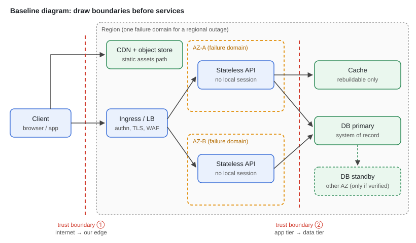
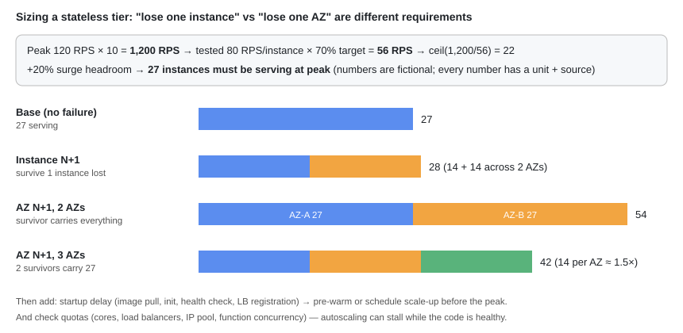
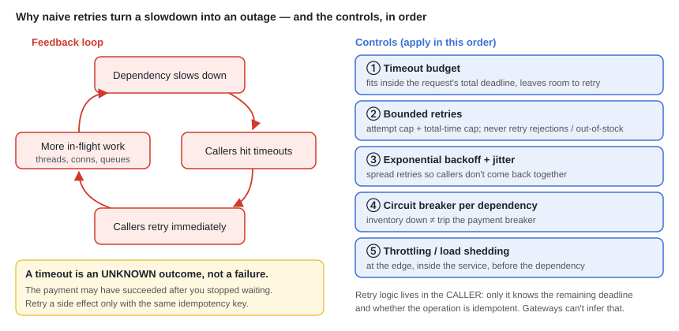
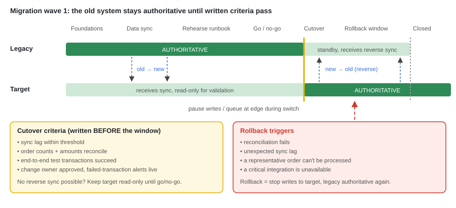
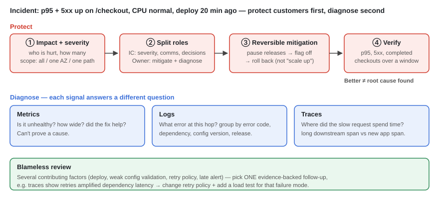
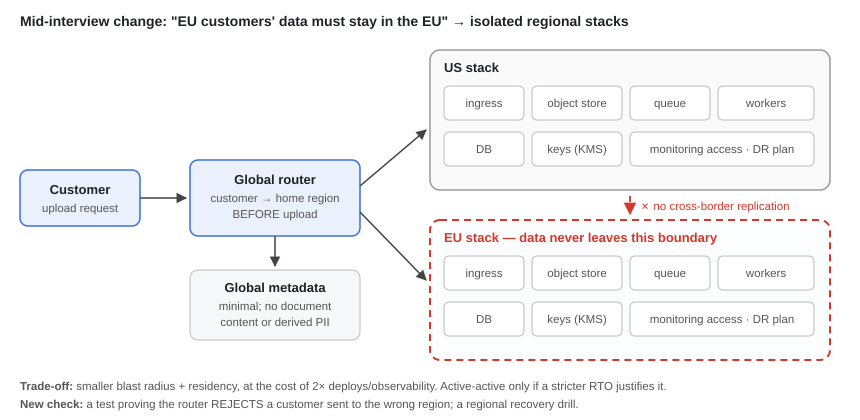
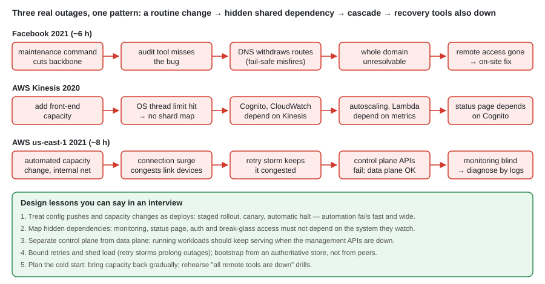

# 05a · SD 速记卡（面试前 10 分钟扫）

> 来源：Educative *Solutions Architect Interview Prep* 全部 31 节文字课 + *Grokking Modern System Design Interview* 按缺口挑读的约 22 节（都在 2026-10-26 读完），只保留 Staff SWE 设计轮（design round）用得上的部分，已用自己的话改写。展开版在 [05](05-system-design.md) 对应小节；经典题速记在本页最后。
> 全课一句话：**面试官不打分你选了哪个服务，打分你说出假设（assumptions）、为取舍（trade-off）辩护、说出什么证据（evidence）会让你改主意。**
> EN: *"The interviewer doesn't grade which service you picked; they grade whether you state your assumptions, defend your trade-offs, and say what evidence would change your mind."*

**目录** 

- [七个随时能套的句式](#h1)
- [第一张图长这样](#h2)
- [十条容易丢分的点](#h3)
- [事故 / 排障](#h4)
- [被改需求（例：数据不能出 EU）](#h5)
- [经典题：每题一句“难点在哪”（Grokking Modern SD）](#h6)
- [中英术语（本页用到的，完整版见 \[05 §6\](05-system-design.md#s6)）](#h7)

## 七个随时能套的句式  [↑ 目录](#toc)

| 场景 | 结构 | 05 位置 |
|---|---|---|
| 需求收束（scoping requirements） | *"We're designing X for Y. Priorities are A and B. I'm assuming C and D; I still need E."* | §1.7 |
| 画完图收尾 | 取舍（trade-off） + 代价（cost） → 会推翻设计的风险（risks that would overturn the design） → 能产生证据的检查（checks that produce evidence） | §1.6 习惯 3 |
| “review this design” | 每个关注点（concern）：风险（risk） → 最小改动（smallest change） → 验证证据（evidence） | §1.6 习惯 2 |
| “为什么用 X” | 需求（requirement） → 决定（decision） → 每个被否方案（rejected alternative）一句理由 → 最不确定的假设（least-certain assumption） + 证据 → 什么会推翻它（what would change it） | §1.8 套路 1 |
| 被反对（pushback） | 改写成可验证的担忧（testable concern） → 一个问题找动因（underlying driver） → 近期/长期（short-term / long-term）取舍 → 缩范围（descope）/缓解（mitigate）/小实验（small experiment） → 谁、何时、交付什么（owner, date, deliverable） | §1.8 套路 3 |
| “如果 X 变慢 / 挂了”（follow-up on a failure） | 先分请求提交前 / 后 → 提交前快速失败（fail fast），说出接受的损失和错误预算（error budget） → 提交后按结果未知（unknown outcome）查状态 + 同一幂等键（idempotency key）重试 → **说出故意不加的组件** → 复查信号 | §1.8 套路 5 |
| Behavioral | S/T 各一句，Action 详细，Result 按证据说，一个教训（lesson learned），一句局限（limitation） | 07 §6 |

## 第一张图长这样  [↑ 目录](#toc)

## 十条容易丢分的点  [↑ 目录](#toc)

1. **可达（reachable） ≠ 授权（authorized）**。私有子网（private subnet）只限定路径（network path）；“谁对什么能做什么”由身份（identity）和策略（policy）决定。每条箭头旁边写一个身份。
2. **托管服务（managed service）减少运维量（operational load），不减少责任（responsibility）**：身份、数据、配置、监控（monitoring）永远是自己的。
3. **冗余（redundancy）要说清防什么**：防丢一台 = N+1 台；防丢一个 AZ（availability zone，可用区；2 个 AZ）= **每个 AZ 都扛全量 → 2×**。
4. **定容（capacity planning）从实测单机容量（measured per-instance capacity）出发**：峰值（peak） ÷（单机 × 利用率（utilization））→ + 余量（headroom） → + 冗余；启动慢就得预热（pre-warming）。
5. **配额（quota）会挡住自动扩容（autoscaling）**：核数、LB、IP 地址池、函数并发（function concurrency）；生产 region 配额可能比开发 region 小。提前查、提前申请、压测（load test）验证。
6. **超时（timeout） ≠ 失败，是结果未知（unknown outcome）**。有副作用（side effect）的调用，重试（retry）要靠**稳定的幂等键（idempotency key）一路带到外部 provider**；每次重试生成新 ID = 重复扣款（double charge）。
7. **重试放在调用方（caller）**（它知道剩余 deadline 和是否幂等（idempotent））；熔断（circuit breaking）**按依赖分开**；明确拒绝（explicit rejection）（校验失败、库存不足）永不重试。
8. **读副本（read replica）是读容量，不是正确性（correctness）**：需要新鲜度（freshness）的读走主库（primary），写明路由规则（routing rule）。CQRS（command query responsibility segregation，读写职责分离）只在读侧需要不同规模/形状时才值得。
9. **多 AZ ≠ region 级 DR（disaster recovery，容灾）**。先问 RTO（recovery time objective，恢复时间目标）/RPO（recovery point objective，恢复点目标）、能否降级（graceful degradation）为只读浏览（read-only browsing），再选最简单够用的档（tier）；failback 也要演练。
10. **迁移（migration）**：旧系统保持权威（authoritative）直到通过标准；切换标准（cutover criteria）和回滚触发（rollback triggers）在窗口前写好；零丢单（zero lost orders） → 回滚（rollback）窗口内保持反向同步（reverse replication），或新系统先只读。

## 事故 / 排障  [↑ 目录](#toc)

- **前三步**：客户影响（customer impact） + 定级（severity） + 范围（scope） → 分开 IC（incident commander，事故指挥）和 owner → 可逆止血（reversible mitigation）（暂停发布、关 flag、回滚（rollback）），每个止血（mitigation）都配成功判据（success criteria）。**止血改善 ≠ 找到根因（root cause）。**
- **metrics** 看是否异常和范围；**logs** 看这一跳报了什么错；**traces** 看时间花在哪一段。
- **逐边界排障（boundary-by-boundary troubleshooting）**：DNS → 路由/回程（routing / return path） → 过滤（filtering） → 身份（identity） → 授权（authorization）；每步说清假设（assumption）、最小区分测试（smallest distinguishing test）、预期结果（expected result）。SYN 超时（timeout） = 还不知道是哪层；TCP reset = 有人主动拒绝；认证错误（auth error） = 网络已通（network path works）。

## 被改需求（例：数据不能出 EU）  [↑ 目录](#toc)

说出哪条假设（assumption）变了 → 上传前按客户归属（customer residency）路由到**隔离的区域栈（isolated regional stack）** → 对比 active-active → 新风险（意外跨境数据流动 / accidental cross-border data flow）+ 新检查（路由拒绝错误归属的测试 / a test that routing rejects wrong-residency data）。

> EN: *"Here's the assumption that changed. I'd route by customer residency to an isolated regional stack before upload, and compare that with active-active. The new risk is accidental cross-border data flow, so the new check is a test that routing rejects wrong-residency data."*

> 其余图（逐边界排障（boundary-by-boundary troubleshooting）、异步（async）下单幂等（idempotent order placement）、读副本（read replica） vs CQRS（command query responsibility segregation）、DR（disaster recovery）四档（four DR tiers））在 [05](05-system-design.md) §2.13 / §2.5 / §2.2 / §2.15 对应位置。

## 经典题：每题一句“难点在哪”（Grokking Modern SD）  [↑ 目录](#toc)

| 题 | 一句话难点 → 答法 | 05 |
|---|---|---|
| 估算（estimation） | 峰值（peak）用 80/20（80% 流量在 4.8 h），不用“全部 DAU（daily active users，日活）同一秒”；出网（egress） ≫ 入网（ingress） → CDN（content delivery network，内容分发网络） | §2.14 |
| Chat | 先落库再转发（persist, then forward）；连接注册表（connection registry） user → WS（WebSocket）服务器；媒体只传 ID；顺序（ordering） > 可用性（availability） | §3.9 #10 |
| News feed | 普通作者 push、大 V（celebrity accounts） pull、读时合并（merge at read time）；只给活跃用户（active users） fan-out | §3.8 |
| Ticketing | 等候室（waiting room）削峰（load leveling）；AVAILABLE → HELD(TTL) → BOOKED，用条件更新（conditional update）抢座（claim the seat） | §3.9 #15 |
| 附近搜索（proximity search） / Uber | geohash 或四叉树（quadtree）；位置写哈希表（hash map），索引慢刷新（index refreshed less often）；按 ID 分区（partition）不按地区 | §3.9 #27 |
| 视频 | 上传转码（transcoding）是异步（async）流水线（pipeline）；播放靠多级（multi-tier） CDN；成本中心（main cost driver）是带宽（bandwidth） | §3.9 #28 |
| 协同编辑（collaborative editing） | 位置漂移（position drift） → OT（中心变换 / central server transforms ops）或 CRDT（字符唯一 ID / unique per-character IDs）；不用锁（no locks） | §3.9 #29 |
| 点赞 / 浏览计数（likes / view counts） | 热点（hot spot） key 拆分片（sharding） + 定期汇总（periodic aggregation），只用于可最终一致（eventual consistency）的计数 | §3.9 #18 |
| 调度器（scheduler） | 按紧急程度（urgency）分队列（queue） + aging 防饥饿（starvation） + 执行上限（execution cap） + checkpoint | §3.5 |
| 大事故（major outage） | 例行变更（routine change） → 隐藏共享依赖（shared dependency） → 级联（cascading） → 恢复工具（recovery tooling）也挂；监控（monitoring）/回滚（rollback）不能依赖被观察的系统（the system being observed） | §2.17 |
| Top-K / 热门榜（trending） | 按 itemId 分区（partition）→ 窗口计数（windowed count）→ 本地小顶堆（min-heap）→ 合并（item 不跨分区所以精确）→ Redis ZSET；放不下才用 Count-Min + Space-Saving；滑动窗口（sliding window）= 分钟桶（per-minute buckets）加新减旧；爆款 key 加盐（key salting）两阶段聚合（two-phase aggregation） | §3.12 |
| Kafka 追问 | 分区（partition）= 并行 + 顺序单位，事后加分区打乱 key 顺序；不丢 = `acks=all` + 副本（replica）3 / `min.insync.replicas=2` + 先处理再提交（process, then commit the offset）；零拷贝（zero-copy）只在读路径；exactly-once 只管 Kafka 内部，外部副作用靠幂等（idempotency） | §2.18 |
| 唯一 ID（unique ID） | 雪花算法（Snowflake）本地算但怕时钟回拨（clock moving backwards）；号段模式（segment allocation）双缓冲提前加载；对外单号用带密钥的打乱（keyed permutation），乘加公式会泄露订单量 | §3.11 |

## 中英术语（本页用到的，完整版见 [05 §6](05-system-design.md#s6)）  [↑ 目录](#toc)

| 中文 | English | 一句话 |
|---|---|---|
| 信任边界 / 故障域 | trust boundary / failure domain | *"Let me draw where trust changes and what fails together."* |
| 风险 → 最小改动 → 证据 | risk → smallest change → evidence | *"Here's the risk, the smallest fix, and how we'd know it worked."* |
| 取舍 + 风险 + 下一步检查 | trade-off, risks, next checks | *"We chose A, it costs B, C would change it, and D would prove it."* |
| AZ 级冗余 | zone-level N+1 | *"With two zones, each zone must carry full peak."* |
| 配额 | service quota | *"Autoscaling can stall on quotas while the code is healthy."* |
| 超时 = 结果未知 | timeout = unknown outcome | *"I only retry a side effect with the same idempotency key."* |
| 读副本 | read replica | *"Replicas add read capacity, not correctness."* |
| 切换标准 / 回滚触发 / 反向同步 | cutover criteria / rollback triggers / reverse replication | *"Legacy stays authoritative until the criteria pass."* |
| 止血 / 根因 | mitigation / root cause | *"Mitigate first; a fix that works doesn't prove the cause."* |
| 改需求 | requirement change | *"That changes my residency assumption — here's the one part of the design that moves."* |
| 分片计数器 | sharded counter | *"Split the hot counter and aggregate periodically."* |
| 损失边界 / 运维负担 | loss boundary / operational burden | *"I'm deliberately not adding a queue; that loss is inside our error budget."* |
| 级联故障 / 隐藏依赖 | cascading failure / hidden dependency | *"Our rollback path mustn't depend on the thing that's down."* |
